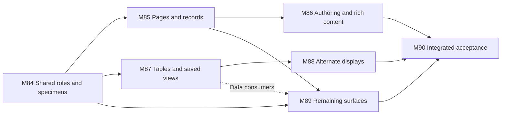

# M84 through M90 product polish implementation sequence

**Implementation authorized · 2026-10-17. Work in progress; acceptance remains evidence-based.**
Design entry point: [Cerebro product polish](../specs/2026-10-17-cerebro-product-polish.md).
This plan follows M71–M83 and changes no earlier completion claim. The owner authorized the
complete sequence on the same branch after checkpoint commit `2347951`. See the
[implementation record](2026-10-17-m84-m90-implementation-record.md) for actual progress and checks.

## Sequence and delivery shape

Deliver a finished page and table before expanding the visual system across every surface.
Each milestone includes its own visual and interaction proof. M90 is integration and native
acceptance, not a deferred design pass.

The first page review includes active authoring states as well as its resting composition:
selection tools, slash insertion, table controls and block manipulation. M86's completion gate
is a complete writing session on the implemented editor. Existing block support does not close
that gate, and the conceptual page preview does not replace it.

M84's review compositions may illustrate the future title order without changing the production
editor. The production title solution is M85.1's bounded spike. Table work can start after M84,
but its shared property/peek integration waits for the M85 anatomy contract. M89 consumes the
completed page/data components; it must not invent variants in parallel before those contracts
are settled.

| Wave   | Work                                                      | Review checkpoint                                                         |
| ------ | --------------------------------------------------------- | ------------------------------------------------------------------------- |
| First  | M84; M85.1 spike; M85.2–.3 complete record and prose page | One compelling real page/peek, not only a component gallery               |
| Second | M86 and M87 in parallel; M88 after M87; bounded M89 lanes | Same records across table/board/gallery/time views, plus actual authoring |
| Third  | Remaining M89 adoption and M90 integration                | Whole-app evidence index and separately recorded native acceptance        |

The title projection and synchronized Gantt split are the largest technical uncertainties.
Do not estimate the remaining phases from screenshot complexity alone. Resolve those spikes
before committing to a detailed delivery date. Broad virtualization, new carriers and new
formatting capabilities are not hidden dependencies of this plan.

## M84 Shared visual roles and compositions

Specification: [surface system](../specs/2026-10-17-cerebro-surface-system-and-quality.md),
sections 2–3. Owner: foundation lane; coordinate `styles/`, shared UI and `PageHeader` edits.

| Phase | Deliverable                                                                                                                                   | Acceptance evidence                                                                                     |
| ----- | --------------------------------------------------------------------------------------------------------------------------------------------- | ------------------------------------------------------------------------------------------------------- |
| M84.1 | Baseline specimen registry and token/consumer inventory, including incorrect `text-base`, stale shell dimensions and dead dark-theme comments | Source ownership map; retained current screenshots; no app default changes yet                          |
| M84.2 | Agreed type, ink/surface, filled-button state, spacing, radius, focus and motion roles; explicit compact/regular variants                     | Real computed colors/contrast in both themes and all button states; no subtree utility overrides needed |
| M84.3 | Shared page/header/toolbar/row/menu/state composition seams with a small number of real consumers                                             | Page, table and pending-decision specimen at wide/narrow sizes; focus/menu/error states included        |
| M84.4 | Owner review of complete compositions; record accepted metrics, exceptions and revisions                                                      | Visual rubric applied to actual specimens; defects resolved before broad adoption                       |

**Exit:** roles are implemented in the selected real consumers, inspected in Chromium/WebKit,
and accepted for use by the following milestones. Merely writing token names is not completion.
Do not change every control or rewrite the shell in one broad CSS patch.

## M85 Pages and records

Specification: [pages and editor](../specs/2026-10-17-cerebro-pages-and-editor.md), sections 3–4.
Owner: page lane. High-risk seam: `DocPage`, `DetailPanel`, `NoteBodyEditor`, title serialization,
editor claims and undo. This lane owns the seam; other lanes request changes through it.

| Phase | Deliverable                                                                                                                  | Acceptance evidence                                                                                                            |
| ----- | ---------------------------------------------------------------------------------------------------------------------------- | ------------------------------------------------------------------------------------------------------------------------------ |
| M85.1 | First-H1 title projection spike and written mechanism decision                                                               | Leading/nonleading/multiple/no H1, concept/agent, title anchors, IME, external update; one writer and no open-time rewrite     |
| M85.2 | One page/peek anatomy: location, identity, required context, properties, tabs, body                                          | Reproduced duplicate/misordered-title fixtures fixed; one visible content title on every related tab; same draft/undo behavior |
| M85.3 | Metadata hierarchy, aligned values, readable long labels, intentional inspector disclosure and responsive section navigation | Saved layout/folds honored; long relation/value editing; drawer focus; unset versus explicit panel preference cases            |
| M85.4 | Completed page specimen and lifecycle regression                                                                             | Table/search/sidebar/deep-link entry, peek→full transfer, pane parking, save/refusal/Undo/reopen, light/dark                   |

**Stop the title implementation at the spike boundary** if it requires a second live editor,
new title storage, lossy body transformation or weaker comment/reconcile behavior. Bring a
concrete alternate composition to review. Other independent M84/M87 work can proceed.

## M86 Authoring and rich content

Specification: [pages and editor](../specs/2026-10-17-cerebro-pages-and-editor.md), section 5.
Owner: editor lane after M85 title ownership is settled.

| Phase | Deliverable                                                                                                   | Acceptance evidence                                                                                                                                           |
| ----- | ------------------------------------------------------------------------------------------------------------- | ------------------------------------------------------------------------------------------------------------------------------------------------------------- |
| M86.1 | Consistent nested prose and block frames for existing carriers                                                | Lists/toggles/columns/quotes, code, tables, media, cards, diagrams, databases, sheets and boards; readable width and source-preserving reopen                 |
| M86.2 | Contextual text/link/table controls, slash/grip menus, block drag/continuation feedback; named callout choice | Carrier-safe conversion, duplicate, move and table structure edits; one-step Undo; visible selection, keyboard access and narrow-pane placement               |
| M86.3 | Comment and reference panel hierarchy with persistent drafts                                                  | Attached/detached/resolved/failed threads, explicit mention invocation, malformed sidecar, title/body anchor behavior                                         |
| M86.4 | Implemented authoring specimen and recorded pointer/keyboard walkthrough accepted by the owner                | Full M86.4 authoring journey; active tools and drag feedback; edit→save→reopen→Undo, outside edit while dirty, failed save, native clipboard/drop/quit record |

Carrier extensions remain separate proposals. Do not re-enable hidden lossy formatting just
because the reference editor shows it. The same rule applies to sheet sizes, merged cells,
cover positioning and richer callout persistence.

## M87 Tables and saved views

Specification: [databases and views](../specs/2026-10-17-cerebro-databases-and-views.md), section 3.
Owner: data lane. It owns `TableView`, `tableAnatomy`, `ViewTabs` and view configuration.
Coordinate shared `FieldEditor` changes with the page lane before editing.

| Phase | Deliverable                                                                                             | Acceptance evidence                                                                                                                       |
| ----- | ------------------------------------------------------------------------------------------------------- | ----------------------------------------------------------------------------------------------------------------------------------------- |
| M87.1 | One data workspace header/control composition for database, list, embed and related tab                 | Explicit scope, active filter/search disclosure, small-container overflow and single primary creation action                              |
| M87.2 | Table defaults and grid states: title allocation, density, padding, borders, type and numeric alignment | 45-row demo plus long values and mixed field kinds; explicit saved widths/density unchanged                                               |
| M87.3 | Consistent title/scalar edit recovery, row stability and keyboard ownership                             | Refused draft retained; one commit; rescan/query exit/deleted target; bulk failure selection; no focus stolen                             |
| M87.4 | Display, schema and database actions have clear scopes                                                  | Delete database removed from display settings; confirmations and checked batch semantics intact; no hidden setting or unsupported control |
| M87.5 | Persistence/performance/visual proof                                                                    | Save/reopen view, source bytes unchanged on presentation-only events, 100/1,000/5,000-row profiling, meaningful browser flows             |

Use measured performance to decide optimization. A new grid engine or virtualization is not
the assumed solution; if required, scope and prove active-editor retention, accessibility,
evaluated totals and scroll restoration before rollout.

## M88 Alternate views and display

Specification: [databases and views](../specs/2026-10-17-cerebro-databases-and-views.md), section 4.
Owner: view lane; table/view-control ownership remains with M87.

| Phase | Deliverable                                                           | Acceptance evidence                                                                                                    |
| ----- | --------------------------------------------------------------------- | ---------------------------------------------------------------------------------------------------------------------- |
| M88.1 | Reflowing list and common board/gallery card anatomy                  | Conditional keys, readable titles, selected fields retained, cover policy, long/unkeyed/mixed-type records             |
| M88.2 | Calendar and time-axis control hierarchy, usable Gantt/table division | Six inherited columns cannot starve axis; real resize/scroll/zoom, row synchronization, undated/recurring/range cases  |
| M88.3 | Chart and dashboard composition                                       | Readable axes/labels/legend, local widget failure, missing measure/zero distinction, drilldown/export and filter scope |
| M88.4 | Calculated and embedded table presentation                            | Clear Markdown Table/Database/Sheet identities, focus and error states; no invented persisted formatting               |
| M88.5 | Cross-view proof over the same corpus                                 | Same filters/group meaning; duplicate memberships; partial totals; save/reopen; 320–1200px containers and both themes  |

Preserve the ten existing view kinds and all settings they support. Whiteboard scene/tool
chrome is adopted with M89, while its database-host framing must remain consistent with M88.
Changing layout is an explicit persisted edit; changing the selected existing tab or merely
measuring a container is not.

## M89 Remaining workspace surfaces

Specification: [surface adoption map](../specs/2026-10-17-cerebro-surface-system-and-quality.md),
section 4. Independent lanes may operate only after shared styles and component responsibilities
are agreed. Every row in that adoption map needs a disposition; these phases group that work.

| Phase | Deliverable                                                             | Acceptance evidence                                                                                                                    |
| ----- | ----------------------------------------------------------------------- | -------------------------------------------------------------------------------------------------------------------------------------- |
| M89.1 | Navigation, Home, Inbox and My work use the approved row/header rules   | Populated lanes/queues, independent failures, silent empty Home lanes, narrow queue/organize inspector                                 |
| M89.2 | Knowledge, Library and Agents have clear reading and decision hierarchy | Guarded Verify, queued proposals, unknown spend/status, off-duty and wait outcomes, grants on Done                                     |
| M89.3 | Active assistant and discussion/results finish                          | Long transcript, tools, attachments, pending Allow/question, refusal/retry, Stop/Steer; panel/canvas preserves one controller          |
| M89.4 | Settings, History and git workflows                                     | All eleven Settings sections, draft retention, partial attribution, readable diffs, unavailable versus no history                      |
| M89.5 | Work, Studio, file/media/PDF and board/diagram chrome                   | Populated isolated roots/project, long filenames, loading/unsupported/read-only/malformed/save-failed states                           |
| M89.6 | Search, create/import/rename, dialogs/menus/toasts                      | Keyboard selection, no-results/failure, import loss report, rename conflicts, nested overlays, destructive confirmation, short windows |

No surface is considered covered because it happens to inherit a changed font. Inspect each
one with real content, a meaningful interaction and an adverse state. Reuse the existing
state lab for readers; add presets only where a new meaningful reading section requires them.

## M90 Integrated acceptance

Specification: [quality contract](../specs/2026-10-17-cerebro-surface-system-and-quality.md),
section 5. Owner: independent verification/review lane, with fixes returned to their owners.

| Phase | Deliverable                                                  | Acceptance evidence                                                                                                                                         |
| ----- | ------------------------------------------------------------ | ----------------------------------------------------------------------------------------------------------------------------------------------------------- |
| M90.1 | Durable specimen index and deterministic visual baselines    | Stable fonts/clock/content, human-reviewed references, exact source revision and geometry; changes reviewed rather than blindly accepted                    |
| M90.2 | Cross-surface journey matrix                                 | Find→open→edit→save→peek/full→related view→comment→assistant decision→history; multi-pane state survives                                                    |
| M90.3 | Accessibility and resilience pass                            | Keyboard-only, VoiceOver, 125/150/200% zoom, reduced motion, both themes/states, short/narrow windows, no unreachable controls                              |
| M90.4 | Required automated gate and final build                      | Appropriate units/coverage, lint, format, three TS configs, Chromium/WebKit; Rust tests/fmt/clippy for Rust/shared changes and repository gate requirements |
| M90.5 | Native acceptance on disposable data and owner visual review | Window/menu/focus, WKWebView input, clipboard/drop/dialogs, open policy/CSP, pending-save quit; explicit pass or outstanding record per case                |

Use the repository toolchain pins for acceptance. Run no watch-mode test command. Preserve
coverage ratchets, hooks and shared-artifact workflows. A real behavioral failure gets a
meaningful regression test; do not add tests that merely restate CSS implementation details.

## Evidence registry required during implementation

The initial minimum set below is a coverage contract, not an exhaustive screenshot cross
product. Each case gets normal and adverse states appropriate to its workflow; changes must
include both themes. Boundary sizes and key interactions receive geometry/behavior assertions.

| ID  | Specimen                      | Required stress                                                                           |
| --- | ----------------------------- | ----------------------------------------------------------------------------------------- |
| P01 | Ordinary prose page           | Nested blocks, long title, no H1, cover/icon combinations                                 |
| P02 | Typed record full/peek        | Expanded properties, duplicate-title baseline, related tab, long labels                   |
| P03 | Concept and agent pages       | Guarded Verify, pending save, grant draft/Cancel, Runs/Memory                             |
| P04 | Rich authoring                | Columns, Markdown table, media, diagram, linked database, sheet, comment anchor           |
| D01 | Table                         | Mixed fields, width/density preferences, focus/selection/edit/refusal, partial bulk write |
| D02 | Board/gallery/list            | Long names, no key/cover, many fields, drag/refusal, narrow host                          |
| D03 | Calendar/timeline/Gantt       | Six-column axis regression, undated data, ranges/recurrence, zoom/resize                  |
| D04 | Chart/dashboard/sheet         | Zero versus unknown, local error, export, pending formula draft                           |
| W01 | Home/Inbox/My work            | Populated queue, silence when empty, scoped read failure                                  |
| W02 | Knowledge/Library/Agents      | Decision cards, review reasons, pending/unknown/paused states                             |
| W03 | Assistant                     | Streaming, pending question/permission, failures, panel/canvas change                     |
| W04 | Settings/History/git          | Drafts, partial attribution, diff and read failure                                        |
| W05 | Work/Studio/files/boards      | Populated data, preview, bad/missing/large file, read-only and save error                 |
| W06 | Search/create/import/overlays | Long labels, query failure, nested menu, validation/loss/conflict                         |

Record window and actual pane widths independently. Core window samples are
900/1024/1280/1440/1920px; add 760×600 as a browser stress case without claiming a new native
minimum. Data/embedded tests include 320/360/480/720/1200px content hosts. A four-pane layout
parks panes according to the existing rules; never force four unusable live slivers to satisfy
a screenshot matrix.

## Change ownership and release discipline

- The owner requested one baseline commit of all existing work, followed by the complete
  implementation on this same branch. Baseline `2347951` is committed; all subsequent
  implementation must remain unstaged and uncommitted. Do not switch branches or create a worktree.
- Shared styles, `FieldEditor`, `DocPage`, `DetailPanel`, view vocabulary and shell layout have
  one lane owner at a time. Parallelism is by surface/component seam, not competing edits.
- Keep existing DOM/test hooks where their semantic role survives. Deliberately update
  assertions tied to superseded presentation, while retaining behavior coverage.
- Default changes must distinguish absent values from explicit saved choices. New view keys
  require parser/serializer, rename/reference and compatibility treatment. Shared semantics
  follow CV-04; no TS/Rust policy twins are introduced as presentation helpers.
- Each phase records changed behavior, visual proof, meaningful checks and remaining gaps.
  Native/live service deferrals remain visible. Owner review of a design does not retroactively
  close older M53–M83 acceptance.

## Authorization and review

The owner authorized the entire M84–M90 sequence after reviewing the reference-based direction.
Proceed through each implementation and verification gate on the existing branch. Keep specimens,
mechanism decisions and remaining acceptance gaps reviewable in the
[implementation record](2026-10-17-m84-m90-implementation-record.md). User acceptance of the final
visual result remains distinct from source completion and automated checks.
