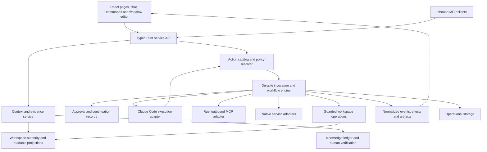

# Cerebro AI expansion: Rust services, connected actions, durable workflows and useful chat

Status: **research and proposed implementation plan, 2026-10-22**. No application
code changes are authorized by this document. It responds to the request to
review Claude's M91 work, add AppFlowy, n8n and Plane to the earlier five-repository
comparison, open up connectors/MCP/actions/subagents, invest in chat, and evaluate
Rust and replacing YAML. Recommendations below are decisions to make concrete in
future implementation specs, not changes already made to Cerebro's contracts.

**Later same-day recheck and UI expansion:** read the
[four-pass UI refresh plan](2026-10-22-ui-refresh-plan.md) and
[current implementation recheck](2026-10-22-ui-refresh-review/01-architecture-recheck.md).
They supersede stale M91 absence claims and establish a parallel visual/interaction
track. The earlier dossiers remain timestamped evidence, not a live feature inventory.

## Recommendation

Build a **Rust-owned execution and workspace service core**, keeping the current
React editor and M91 presentation investment. Give chat, workflows, agents, human
commands and MCP access to the same catalog of typed actions, account bindings,
approvals and recorded outcomes. Make the chat experience the main way a person
discovers, supervises and uses that capability.

For YAML, the ambitious option worth pursuing is **SQLite-owned typed metadata
with Markdown bodies**, provided the product intentionally trades files-alone
portability for transactional records and richer automation. Prototype it against
Markdown plus JSON sidecars before selecting the authority model. Removing YAML
from the UI is useful immediately; changing a delimiter or serializer will not
deliver the architectural benefits. Neither format migration nor an all-Rust UI
rewrite is a prerequisite for connected actions and better chat.

The highest immediate priority is finishing M91 as an integrated feature. Its
Rust event producer and frontend consumer currently disagree about child events.
The new component library is substantial work, but its existence does not yet
establish a functioning subagent/chat journey. Keep M91 completion separate from
the larger platform investment, and reconcile this dated audit with Claude's
next handoff before assigning duplicate work.

The refreshed UI is a separate first-class investment: consistent document,
collection and utility compositions; refined density and controls; reliable creation,
properties and return paths; and integrated chat. UI01/02 in the refresh plan can
proceed without a storage migration or new action engine. Features promising new
runtime state retain the AX dependencies below.

## Evidence and reading order

This extends the [earlier strengthening plan](2026-10-22-reference-strengthening-plan.md)
and its five repository dossiers. It changes the direction of some deliberately
deferred product bets; it does not erase their unresolved correctness findings.

| Document                                                                                            | What it decides or establishes                                                                                        |
| --------------------------------------------------------------------------------------------------- | --------------------------------------------------------------------------------------------------------------------- |
| [M91 current-state audit](2026-10-22-ai-expansion-review/m91-current-state.md)                      | What is implemented, partially integrated and still planned; reconciliation of CP01–CP13                              |
| [AppFlowy comparison](2026-10-22-ai-expansion-review/appflowy.md)                                   | Context, durable conversations, answer-to-page actions, Rust services, local/cloud boundaries                         |
| [n8n comparison](2026-10-22-ai-expansion-review/n8n.md)                                             | Action/credential catalogs, workflow versions, approvals, child jobs, artifacts and two different agent architectures |
| [Plane comparison](2026-10-22-ai-expansion-review/plane.md)                                         | Contextual commands, work/page relationships, versions, integration UX and webhook history                            |
| [Rust and storage decision study](2026-10-22-ai-expansion-review/rust-and-storage.md)               | Rust ownership versus UI rewrite; five storage options; migration and rollback                                        |
| [Connectors and workflows architecture](2026-10-22-ai-expansion-review/connectors-and-workflows.md) | Proposed shared runtime, object contracts, state transitions and end-to-end slices                                    |
| [Chat and agent experience](2026-10-22-ai-expansion-review/chat-and-agent-experience.md)            | Concrete user journeys, information hierarchy, interaction states and acceptance                                      |
| [MCP compatibility](2026-10-22-ai-expansion-review/protocol-compatibility.md)                       | Current local wire contract versus current official protocol; staged extension support                                |
| [Independent challenge review](2026-10-22-ai-expansion-review/architecture-challenge.md)            | Corrections, unresolved decisions and risks in this proposal                                                          |
| [Evidence index](2026-10-22-ai-expansion-review/README.md)                                          | Scope, provenance, source fingerprints and validation limits                                                          |

These are source reviews of local snapshots and a changing Cerebro working tree,
not competitive product benchmarks or claims that the reference applications were
run. Repository names and version strings do not establish upstream commit IDs.
The review records license and external dependency boundaries without assuming
that a visible feature is available in every edition. Use the dossiers' source
links for implementation evidence, and their timestamps/hashes to detect drift.

## What each reference actually contributes

| Reference    | Most useful lesson                                                       | Adaptation for Cerebro                                                          | Limit of the comparison                                                                        |
| ------------ | ------------------------------------------------------------------------ | ------------------------------------------------------------------------------- | ---------------------------------------------------------------------------------------------- |
| Macro        | Trace/read boundaries, retrieval evaluations, exact navigation           | Run/evidence inspection and outcome evaluations                                 | Existing Cerebro architecture already borrowed heavily; avoid scheduling parity as new work    |
| Morrow       | Failed-save recovery and source-oriented writing                         | Retain unsaved drafts, precise passage landing and source escape hatch          | No demonstrated model-agent runtime to borrow                                                  |
| Tolaria      | Bounded editor loading and measurable responsiveness                     | Profile load/parse/mount; preserve readiness and native input correctness       | Speed claims from another editor do not establish Cerebro performance                          |
| Thought Desk | Large-view behavior, capture and heterogeneous records                   | Bounded view derivations and useful intake                                      | Its deterministic rules are not agent orchestration                                            |
| Activepieces | Versioned execution, waits and sample input/output                       | Workflow rehearsal, run manifests and recovery journeys                         | Server workflow infrastructure must be reduced to a desktop ownership model                    |
| AppFlowy     | Rust services under a rich UI, context/source selection, persisted chat  | Rust-owned conversation/workspace services and answer-to-artifact flow          | Flutter UI; MCP module not exported in the snapshot; cloud implementations are partly external |
| n8n          | Reusable actions, credentials, durable continuation, agent task identity | One execution system across chat, workflows and agents                          | Legacy and newer agent stacks differ; edition/deployment/license boundaries matter             |
| Plane        | Contextual work commands, relationships, page versions and webhook logs  | Predictable commands, typed record actions and inspectable integration delivery | Inspected AI affordances do not establish a complete chat/subagent/MCP platform                |

Cerebro's own strengths remain valuable: scoped guards, shared policy artifacts,
human-only knowledge verification, source provenance, journaled local batches,
operational run records, durable wake claims, one live editor per path and a
persistent assistant across presentations. The expansion should reuse those
mechanisms while changing the specific contracts that limit the intended product.

## M91: finish the data path before increasing the promise

At the first audit checkpoint, explicit CLI built-in admission, structured Rust
events, child transcript folding and many AI components were present. The later
same-day recheck found the researcher preset, delegation ceiling and request/policy
fields actively landing. Verify their artifacts, Rust/TS loaders, runtime admission,
Settings and recorded CLI behavior as one coherent handoff. Complete delegated
accounting, ordered frontend parts, nested child consumers, context-use pull,
branch execution and production component adoption remained open at the recheck.
The browser also exposed an intermediate artifact/loader startup failure; its final
disposition is recorded in the refresh evidence rather than treated as a shipped bug.

The critical mismatch is source-confirmed: Rust emits parent-tagged text/tools/
errors, but the old frontend reducer can flatten children into the main answer and
ignore newer structured events. This was not live-reproduced. Its required fix is
the completion of M91.4 and its consumers, not a second competing transcript model.
See [the audit's concrete findings and fingerprints](2026-10-22-ai-expansion-review/m91-current-state.md).

Deliver M91 in this order:

1. Complete the execution contract: explicit delegation policy, allowed researcher
   identity, settings precedence, foreground bounds, fail-closed drift handling,
   and measured whole-tree usage with an unknown state where needed.
2. Complete one event projection for live, replay and recovery. Keep main answer,
   narration, child results, reasoning summaries, approvals and effects distinct.
3. Adopt the components in the actual assistant, run detail, Agent pages, comment
   turns and review surfaces; retain one conversation instance across layouts.
4. Integrate attachments, context and server-validated branches. A branch changes
   conversation ancestry; it does not undo files or remote actions.
5. Close recorded CLI and packaged native acceptance. Component tests and synthetic
   folds are useful evidence but do not replace those checks.

Do not close the earlier CP09 merely because Rust can now read sidechains. Conversely,
retire the old premise that every sidechain is dropped: M91 has materially improved
that layer. Keep CP01 failed-save recovery, CP02 truthful scoped history, CP04
performance and CP13 retryable readiness on the near-term track. More workers will
make those existing defects more visible.

## Target product and architecture

A person should be able to say: “Review this project's changes, ask a researcher
to check the supporting material, propose updates to the work items, and prepare
the external follow-up.” Cerebro should show the selected sources and accounts,
the children's contributions, the proposed effects, and what actually completed.
After closing and reopening the app, the person should find the same answer,
pending decisions and uncertain effects.

This is a proposed application design, not a requirement from any reference repo.
The CLI is one execution adapter. Existing direct connector forwarding remains a
clearly labeled compatibility path while the broker matures; it cannot promise the
same observation, continuation or recovery guarantees as brokered actions.

### One action contract, several entry points

An action needs a stable identity, versioned input/output schema, connection/account
binding, locally governed effect class, capability requirements, cancellation and
retry semantics. A tool name and description are insufficient. Give the same
action to a human command, chat tool, Agent grant or workflow step through the same
resolver. Data from an MCP server does not grant itself permissions.

An invocation records the frozen definition and input, originating vault/run/
child, account version, approval reference, attempts and observed result. Preserve
`outcome_unknown` after a dispatched mutation loses its response. A unique local
dispatch claim does not prove exactly-once behavior in another system. Offer
reconciliation before retry unless the provider offers a usable idempotency or
status contract. A compensating remote action is another recorded action; local
Undo cannot pretend to reverse it. A catalog snapshot freezes what Cerebro reviewed,
not the remote server's implementation. Recheck current schema/account revisions
before dispatch and reject incompatible drift. A new transport request ID must not
become a new business invocation or idempotency key; disable or bound SDK retries
that could repeat a mutation without the action runtime deciding.

Retain unresolved effect evidence beyond ordinary transcript cleanup. Bind approval
to validated account identity and semantic inputs; routine token refresh for that
same account is not account replacement. Revocation, changed identity, broader
scope or changed targets still require reevaluation.

Use existing runtime transactions, wake claims and guarded writers as foundations.
Keep operational history separate from the knowledge ledger. An external delivery
failure is not automatically an epistemic event. The same separation applies to
chat transcripts: generated answers must not become verified knowledge simply
because Cerebro now stores them durably.

### Connections and MCP as a visible product

Connections should show account, usable actions, health, missing sign-in and repair.
Keep an advanced custom MCP option. Permit multiple accounts for the same provider
without ambiguous labels or credential fallback. Store secret references in
portable configuration and resolve them through a Rust credential service; current
header/env values need an explicit migration, not silent inclusion in exports.

Keep three planes distinct: other apps calling Cerebro's MCP server; Cerebro
calling third-party MCP; and deterministic workflow dispatch. Add resources as
inspectable context and prompts as editable starting material. Pin and test protocol
adapters against actual clients. The local server currently declares `2025-06-18`;
current official documentation describes a materially changed `2026-07-28` contract.
Do not merely change the version constant. See [protocol compatibility and official
sources](2026-10-22-ai-expansion-review/protocol-compatibility.md).

Start rich results with Cerebro-owned table/file/proposal renderers. Prove one
sandboxed MCP App later through the same action authority and packaged navigation
policy. Do not mount untrusted connector HTML with application IPC privileges.

### Workflows as saved, reviewable execution

Start with a step list and inspector: trigger, read/query, bounded transform,
condition, action, approval/wait and result. Store a typed JSON definition with
stable step IDs and separate draft/published versions. JSON here is a workflow
serialization decision; it does not require converting every page's metadata.

Freeze the version on each run. Editing a workflow while it waits must not change
the work that resumes. Store step input/output references, attempts, wait reasons
and uncertain effects. Offer sample inputs and a deterministic preview; a live
rehearsal requires genuine isolation of filesystem, credentials, network and tool
effects. A copied vault alone is insufficient.

Use a graph as a later view over the same definition when branches and joins
justify it. Avoid an independent canvas-only execution model. Explicitly distinguish
local schedules that run when the app can dispatch from always-on execution;
sleep, app closure and catch-up need clear semantics. Public webhook delivery or
always-on operation requires an optional service/relay design, not a hidden promise
from durable local queues.

### Subagents with accountable identity

M91's child is a worker of its parent's run. It shares that identity and its
attribution; a nested trace does not create an independently authorized Agent.
Retain that bounded researcher as the first useful experience.

The next mode is a Rust-owned child job with objective, input evidence, output
schema, parent ID, grant intersection, budget, deadline and cancellation state.
An Agent page can supply instructions and a maximum grant, but the parent may
delegate only its own permitted subset. Independent workers need separate scoped
execution credentials or an equally enforceable runtime boundary; a prompt saying
“read only” is insufficient. If a backend cannot suspend a child for approval, it
must not accept a task that requires that capability.

Existing Agent handoffs already have independently granted actor semantics. This
new supervised-child mode is a distinct operation; do not silently change handoff
authority while adding it.

Add reviewer/planner/researcher presets before arbitrary background teams. Show
contributions and failures individually. Parent cancellation can request child
termination without asserting all external effects have stopped. Delay background
execution until job ownership, restart recovery and waiting approvals are proven.

### Chat as the complete work surface

The composer should make context, attachments, selected capabilities/accounts and
model/backend availability understandable without requiring infrastructure terms.
The answer should lead with the outcome, useful output and decisions needed.
Expandable details explain reads, child work and tool progress; consequential
failures and pending approvals stay visible.

Move thread identity, ancestry, message/attempt references, context receipts and
artifacts behind Rust storage with incremental reads. Explicitly decide whether
normalized completed messages outlive CLI transcript retention. An app-owned
readable archive does not guarantee that the CLI can resume a deleted native
session. Keep generation retry, conversation branch, workflow continuation and
remote-action retry as four different operations.

Add Save answer, Add selected parts to page, Open artifact, Compare and Export
through existing viewers/writers. Every artifact identifies whether it is a
preview, saved workspace object or external result. Citation clicks should open
the actual version/passage read, with a changed-source fallback. Distinguish
selected context, available context, actually read content and claim-supporting
evidence. A URL mentioned in an answer is not proof it was read.

## Rust and YAML: proposed decisions

| Decision                        | Recommended direction                                      | Why / decision boundary                                                                                                          |
| ------------------------------- | ---------------------------------------------------------- | -------------------------------------------------------------------------------------------------------------------------------- |
| Domain and service ownership    | Move toward Rust as the authoritative owner                | Common actions, grants, schema validation, queries, workflow state and persistence; generated DTOs reduce handwritten wire drift |
| Current UI                      | Keep React and the browser editor                          | Preserve editing, IME, accessibility and M91 investment; move business rules without IPC on every keystroke                      |
| All-Rust UI                     | Separate optional prototype                                | Require measured benefits on real editor/large-view/native journeys before committing a rewrite                                  |
| YAML visibility                 | Remove from normal authoring paths                         | Typed forms, schema editors, workflow inspectors and Agent settings should make valid changes without exposing serialization     |
| New workflow/config definitions | Versioned typed JSON                                       | Portable data structures and migrations without adding new YAML-dependent features                                               |
| Existing page metadata          | Prototype SQLite metadata + Markdown against JSON sidecars | Select transactions and automation versus files-alone portability explicitly; do not hide the tradeoff behind “local first”      |
| Full structured/CRDT documents  | Defer unless collaboration/rich-document needs justify it  | Larger editor, persistence, import/export and knowledge-identity change than removing YAML                                       |
| Additional model backends       | Introduce an interface, then one proven backend            | Current CLI stays usable; every backend declares tools, attachments, continuation, usage and cancellation capabilities           |

Rust does not automatically solve React rendering costs, ambiguous identity,
serialization loss or poorly scoped queries. Benchmark the existing large-view
workload and editor path. Optional Rust/WASM reuse can reduce semantic twins in
browser mocks, but adds its own build, portability and test constraints; decide
through a vertical slice rather than a blanket language rule.

YAML currently describes schemas, relations, Agent grants, source provenance and
other protected semantics, as well as ordinary fields. Sheet fences also contain
YAML. A serious removal plan inventories those carriers, unknown keys and scalar
types, null/absence, invalid documents, duplicate keys, comments/anchors and raw
bytes before any conversion. Existing LF/CRLF/BOM behavior is not byte-perfect
round-trip preservation. Preserve original bytes for rollback independently of
the normalized target representation.

For SQLite metadata, define a distinct canonical workspace store and backup/sync
contract. Existing `runtime.db` is also non-reconstructible operational data; do
not treat it like the disposable knowledge index. Keep Markdown bodies editable
through a documented import/reconciliation boundary. Introduce stable record IDs,
path aliases and external identity mappings before rewriting relations. Preserve
historical verification/ledger events; add mapping/migration records rather than
rewriting old evidence to make it look born in the new format.

Ordinary page display titles continue to derive from the first top-level H1;
database metadata must not introduce a second title writer. Concepts retain their
guarded title semantics. Define these projections before converting records.

Migration must have one authoritative representation at every phase. Shadow
conversion and comparisons are useful; indefinite two-way YAML/DB writing is not
a transition plan. Stop writers at cutover, persist recovery state across file/DB
changes, publish the authority marker last, and prove restart/rollback with real
mixed documents. After new-format writes, rolling back requires a tested reverse
migration or preserving those writes separately, not simply restoring an old
backup and losing work. The [decision study](2026-10-22-ai-expansion-review/rust-and-storage.md)
specifies the options and migration boundaries in detail. An application lock does
not stop an external editor. Prefer a migrated copy and a new workspace registration,
leaving the original untouched; detect/reconcile subsequent original-folder edits.
In-place cutover requires proven writer quiescence or explicit conflict handling,
not merely a hash check followed by an assumed exclusive rename.

The CLI currently can use raw Write/Edit outside Cerebro's guarded write doors;
M91 observes child writes but does not turn observation into enforcement. A claim
that Rust exclusively owns metadata requires constraining that path and shell
access to canonical stores, or explicitly admitting a compatibility/import mode
with weaker guarantees. Do not claim “one writer” from a module diagram alone.

## Explicit amendments to existing decisions

These are proposed amendments for the requested direction. The old constraints
describe the current product; they are not a veto on this research. Approving a
future implementation spec should identify the exact amendment it takes.

| Current contract                                     | Proposed amendment                                                                                              | What must remain explicit                                                                                                |
| ---------------------------------------------------- | --------------------------------------------------------------------------------------------------------------- | ------------------------------------------------------------------------------------------------------------------------ |
| CLI is the execution transport                       | Rust service boundary with CLI as the first adapter; direct MCP/native actions can execute without a model turn | No silent replacement of the person's CLI subscription or setup                                                          |
| Connectors largely use user/CLI configuration        | First-class Rust account and credential broker                                                                  | Model credentials, integration secrets and inbound client tokens remain separate                                         |
| Imported outside content and drafts-only mail policy | Permit selected external mutations under action-specific owner policy                                           | Read, draft, create/update, send, publish and delete are distinct permissions; mail send needs its own approved behavior |
| CLI session file is transcript authority             | Optional app-owned normalized conversation retention                                                            | Retention, deletion, export and native-session resumability must be stated separately                                    |
| File/YAML metadata is authoritative                  | Selected workspace metadata authority model                                                                     | SQL plus export changes the files-first promise; sidecars keep a file-based authority with different atomicity costs     |
| Same-run bounded researcher                          | Independent scoped child jobs after continuation/accounting work                                                | Identity/grants cannot be simulated with UI labels or prompts                                                            |
| Twinned TS/Rust vault semantics under shared cases   | Gradual Rust authority and generated contracts where useful                                                     | Preserve parity until each old implementation is actually retired                                                        |

Human-only knowledge verification, honest missing/unavailable states, source scope,
recoverable human drafts and explicit effects should remain product guarantees
unless separately reconsidered. No need to weaken them to add powerful actions.

## Delivery plan

Use provisional **AX** package IDs here to avoid claiming the next milestone
numbers while Claude is finishing M91. Estimates are rough engineer-weeks including
focused verification, with substantial uncertainty. They overlap and are not
additive delivery promises. Name a primary owner per package even when agents help.

| Package | Outcome and first reviewable deliverable                                                                      | Dependency                                      | Owner skill / rough effort                              |
| ------- | ------------------------------------------------------------------------------------------------------------- | ----------------------------------------------- | ------------------------------------------------------- |
| AX00    | M91 handoff matrix, integrated researcher turn, truthful replay; CP01/02/13 fixes remain visible              | Current work reconciliation                     | Rust + frontend, 2–4 remaining weeks subject to handoff |
| AX01    | Rust service interfaces, action/connection IDs, immutable manifests, generated wire contract pilot            | AX00 interface agreement; may start in parallel | Rust architecture, 2–3                                  |
| AX02    | Account/connect/test/reconnect/revoke and secret references; custom MCP retained                              | AX01                                            | Integrations + desktop, 3–6                             |
| AX03    | Brokered MCP tools plus context resources/prompts; tested old/new compatibility matrix                        | AX01/02                                         | Rust integrations, 4–7                                  |
| AX04    | Invocation/effect ledger, durable approval claims and unknown-outcome reconciliation                          | AX01; with AX02/03                              | Rust runtime, 4–7                                       |
| AX05    | Durable thread metadata, ordered replay, context receipts, source passage opening and useful artifact actions | AX00/01; uses AX04 for effects                  | Frontend + storage, 4–7                                 |
| AX06    | Three end-to-end connector journeys, schema forms and action-level grants                                     | AX02–05                                         | Product integration, 2–4 incremental                    |
| AX07    | Versioned step workflows, preview, waits, catch-up and inspectable resume                                     | AX04/06                                         | Runtime + product UI, 6–10                              |
| AX08    | Independent scoped child jobs, result schemas, parent cancellation and accounting                             | AX00/04/05; backend capability proof            | Agent runtime, 4–7; background mode separately          |
| AX09    | Workspace authority comparison prototype and conversion report; no production migration                       | Can run after AX01 in parallel                  | Storage + editor, 4–6 spike                             |
| AX10    | Selected YAML-removal migration and canonical metadata/query service                                          | AX09 decision; recovery/sync proof              | Storage + frontend, 16–28+                              |
| AX11    | Additional execution backend and one sandboxed MCP App                                                        | Stable AX03–05; separate capability decisions   | Integrations + frontend, 3–6 each                       |
| AX12    | Outcome evaluation suite, native acceptance and repeatable scale baselines                                    | Starts AX00; expands per package                | Cross-functional, budget within every package           |

The storage study uses two-engineer team-weeks: its 2–3 week prototype and 8–14
week hybrid migration correspond to AX09's 4–6 and AX10's 16–28 engineer-weeks.
Other rows describe narrower increments and shared work; do not total all dossiers.

### Narrow beta: one connection, one useful action, one honest recovery

After M91 integration, prove one provider with a read and reviewed issue creation.
Use a purpose-built preview, one account, a tested protocol already supported by
the CLI, existing conversation retention, and the minimal durable action/approval
record needed to reopen its result. Demonstrate remote success with a lost response.
This beta validates the architecture before broad discovery, generic schema forms,
permanent chat archives, modern inbound protocol support or multiple providers.
Prove that the CLI receives only the scoped Cerebro broker tool for that managed
connection: the raw provider server and credential must not also be forwarded.
Demonstrating the legacy direct path cannot establish the broker's stronger effect
and approval contract.

### First release train: connected research and controlled external updates

Finish the existing reliability repairs and expand AX01–05 from the beta. Deliver
the following three slices incrementally rather than treating them as one small
launch or a broad connector marketplace:

1. **Research a project using a custom MCP resource/tool.** Connect and test,
   choose a scope, run two researchers, follow supporting passages and save the
   resulting report. Source failure stays visible.
2. **Turn a reviewed finding into an external work item.** Start with one selected
   issue service, such as GitHub or Plane, after inspecting its actual integration
   capability. Show account, target and exact payload. Record success or unknown
   effect. Reopen and reconcile without creating duplicates.
3. **Read correspondence and prepare a draft.** Reuse current approved import/draft
   behavior and provenance. Sending remains a separate, explicit expansion; this
   useful first release does not depend on implementing send.

The work-item provider choice is a product selection, not a claim that any
particular third-party MCP server already exposes the required methods. A native
adapter is valid where a stable API better supports the required receipt and
idempotency contract. Keep adapters small and interoperable with the same action
catalog.

### Second release: repeat the work reliably

Save the successful journey as a versioned workflow; add wait/approval, schedules,
bounded conditions and a clear run history. Introduce independent Agent children
only after their permission and continuation contract is proven. Expand connector
coverage according to repeated user tasks, not raw tool counts. Resolve the storage
decision through AX09 while these features deliver value.

### Later bets

Production metadata migration, an additional model backend, MCP Apps, background
workers, webhook relay/always-on service and a graph editor each need their own
acceptance slice. An all-Rust UI remains an optional experiment with a separate
editor/accessibility budget. Do not put every bet on the critical path for the
first connected task.

## Acceptance and evaluation

Measure completed user tasks, not the number of ports or components. The following
are proposed release gates; they are not results from this research.

| Journey                     | Evidence required                                                                                                                                     |
| --------------------------- | ----------------------------------------------------------------------------------------------------------------------------------------------------- |
| Connect two accounts        | Distinct labels and grants; expired auth is repairable; changing accounts invalidates a stale approval                                                |
| Research with children      | Stable parent/child identity; one child's failure does not replace the main answer; known and unknown usage remain distinct                           |
| Approve an action           | Exact preview binds to execution; double clicks/two surfaces yield one local claim; changed arguments require a fresh decision                        |
| Recover an ambiguous write  | Lost response produces outcome-unknown; restart does not automatically repeat it; reconciliation explains the next safe action                        |
| Continue a waiting workflow | App restart retains the original version, account and wait; edited drafts do not alter the waiting run                                                |
| Reopen a rich conversation  | Same ordered answer, child summaries, sources and effects; unavailable raw transcript is distinguished from empty history                             |
| Use a source or output      | Passage navigation and changed-source state; saving an answer is one undoable local write; preview versus saved artifact is obvious                   |
| Switch presentation or pane | Draft, stream, reading position and pending decisions survive; keyboard/VoiceOver/IME operate in packaged builds                                      |
| Migrate metadata            | Unknown fields and protected semantics preserved or explicitly blocked; interrupted cutover recovers; export/restore and post-cutover rollback tested |
| Work at scale               | Repeat existing retained workloads with declared hardware/build; improve measured latency without losing accessibility or correctness                 |

Keep a small versioned task corpus: expected sources and passages, permitted
actions, required approvals, expected artifacts, failure injections and cost/time
budgets. Include a malicious source/tool description that tries to broaden scope;
an expired account; interrupted child; moved page; deleted CLI transcript; revoked
permission while waiting; and remote success with lost response. Score evidence
support, task completion, unauthorized-effect prevention, recovery accuracy,
latency and measured cost separately. Unknown data is a visible outcome, not zero.

Start with 10–15 representative tasks and repeat them across prompt/runtime changes.
Extend existing policy, conformance, CLI recording and state-lab infrastructure.
Native and live-service trials need isolated test accounts/vaults and retained
sanitized evidence. This planning review did not run those trials or the reference
applications.

## Decisions to settle before implementation packages begin

The recommendation is concrete enough to start AX00 and draft AX01 contracts.
Before dependent implementation, record the selected answers to these decisions:

1. Is long-term metadata authority **SQLite plus Markdown** or **Markdown plus JSON
   sidecars**? The prototype must compare external editing, Git/sync, backup,
   rollback, query costs and agent tooling on the same corpus.
2. Which external mutations are allowed by default, which require a preview, and
   which need a separately enabled capability? Specify send/publish/delete rather
   than one blanket “write access.”
3. Should completed normalized chat content outlive CLI files, and for how long?
   Define deletion/export and whether the person can opt out.
4. Is this a desktop-awake workflow product initially, or is always-on execution
   part of the target? The latter is a deployment/credential decision of its own.
5. Which second execution backend, if any, solves a real need beyond the person's
   CLI? Prove capability coverage before changing the default.

These decisions do not require another broad redesign document before finishing
M91. They let the next work land as a sequence of useful, reviewable capabilities
with explicit boundaries and evidence.
