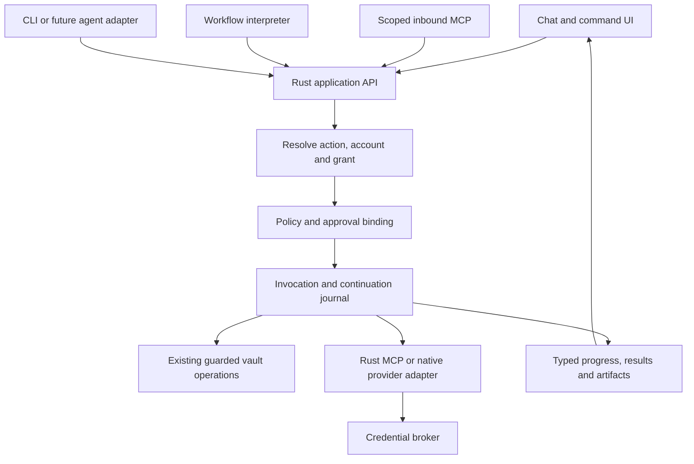

# Connectors, MCP and workflows: one Rust execution core

Research checkpoint: 2026-10-22. This is a proposed architecture, based on the
current working tree and the [n8n](n8n.md), [AppFlowy](appflowy.md) and
[protocol compatibility](protocol-compatibility.md) reviews. No implementation,
provider sign-in, external action or live protocol test was performed for this
document. Existing product decisions are the baseline being reconsidered, not a
veto on the owner's requested expansion.

The recommendation is to make **a connection and an action durable product
objects, owned by Rust**. Chat, a saved workflow, an independent agent and an
inbound MCP client should invoke the same checked action. The UI should explain
which account will act, what will change and how a stopped run can recover. More
connector names or a workflow canvas alone will not supply those guarantees.

## 1. What exists, and what the references actually add

Cerebro already has valuable execution machinery:

| Existing foundation                                                                                   | Evidence                                                                                                                                                                                  | Expansion still required                                                                         |
| ----------------------------------------------------------------------------------------------------- | ----------------------------------------------------------------------------------------------------------------------------------------------------------------------------------------- | ------------------------------------------------------------------------------------------------ |
| Per-vault connector configuration, exact machine approval fingerprints, strict per-run selection      | [connectors.rs](../../../../src-tauri/src/connectors.rs), module contract and `read_raw_checked`; [ConnectorSettings](../../../../src/app/ConnectorSettings.tsx), status and sign-in flow | First-class accounts, discovered capabilities, action schemas and app-owned invocation lifecycle |
| Scoped inbound MCP under run bearers; separate opt-in loopback personal-token listener                | [mcp.rs](../../../../src-tauri/src/mcp.rs), `Grant` and `handle_rpc`; [client_access.rs](../../../../src-tauri/src/client_access.rs)                                                      | A deliberate outbound client, resources/prompts UX and compatibility adapters                    |
| Human permission gates and one-use approvals bound to the exact vault, session, actor, tool and input | [interaction.rs](../../../../src-tauri/src/agent/interaction.rs), module contract and `take_write_approval`                                                                               | Durable external-action approvals and continuations that survive app exit                        |
| Atomic run admission, budget reservations, leases and recovery                                        | [dispatch.rs](../../../../src-tauri/src/runtime/dispatch.rs); [wakes.rs](../../../../src-tauri/src/runtime/wakes.rs)                                                                      | Step-level execution and remote-effect reconciliation                                            |
| Bounded self-follow-ups and event-triggered agents                                                    | [followups.rs](../../../../src-tauri/src/runtime/followups.rs)                                                                                                                            | A typed multi-step workflow definition, immutable published versions and saved waits             |
| Shared policy facts and guarded vault writers                                                         | [tools.v1.json](../../../../shared/policy/tools.v1.json); [tool_approval.rs](../../../../src-tauri/src/policy/tool_approval.rs)                                                           | Explicit external-effect policy and one shared enforcement route                                 |

The current interaction book is explicitly memory-only: its module documentation
explains that quit drops the book, and a later send settles an unanswered deferred
call as refused. This is meaningful recovery behavior, but not a durable approval
inbox. Likewise, a transactional local wake claim does not establish whether a
remote service accepted a request before the network failed.

n8n contributes concrete patterns: separate credential and action definitions,
versioned nodes, saved workflow executions and waits, typed child tasks and
execution checkpoints. Its newer agent runtime and older workflow subagent
runtime have different approval capabilities; the [review](n8n.md) documents both.
AppFlowy supports the value of Rust application services and inspectable chat
context, but its reviewed MCP module is not an active production connector
catalog. Neither reference justifies importing a distributed server topology into
a personal desktop application.

M91 supplies policy, stream-fold and presentation work in progress. Nested worker
events are useful evidence; they do not turn the current CLI's child into an
independently scoped Cerebro actor. Complete the
[M91 source audit](m91-current-state.md) acceptance before treating its planned
features as stable integration points.

## 2. Separate the four execution paths

**Inbound MCP** lets the user's CLI or another authorized application call
Cerebro. Retain existing bearer, vault, actor and tool guards. A request's wire
session must not become its authorization identity; the application run and
invocation remain explicit. External clients receive only approved action
capabilities and cannot answer a person's pending approval themselves.

**Outbound MCP today** is largely configuration handed to Claude Code. The CLI
owns its connection and OAuth lifecycle; Cerebro observes aspects of execution.
**Outbound MCP proposed** is a Rust connection manager that discovers and invokes
third-party capabilities through the action core. HTTP/native provider adapters
can implement the same contracts where MCP is unavailable or unsuitable.

**Workflow execution** is a Rust interpreter over saved, typed steps. It owns
continuation and effect state. An LLM may propose the definition or produce a
step's structured result; a model message is not the workflow engine.

**Agent execution** produces plans, answers and action requests through an adapter.
The first adapter remains the user's CLI. A later provider or harness adapter
must declare actual streaming, tool, checkpoint, usage, cancellation and child
capabilities; unsupported operations cannot be inferred from a common interface.

Do not implement two active authorities for one connection. During transition,
each connection declares `execution_owner: cli | cerebro`. A CLI-owned connection
keeps its present limitations visible. A Cerebro-owned connection is exposed to
the CLI through scoped broker tools, without also handing it the raw remote
server. Switching ownership requires account verification and explicit grant
rebinding. Configuration discovery alone cannot migrate an OAuth session.

The common core wraps existing vault guards; it does not replace their policy,
locks, receipts or human-only verification rules. Direct CLI filesystem tools
remain a separate current route: action records must not imply those writes all
passed through Cerebro's receipted writer. Either retain that distinction or make
a separately tested decision to narrow that route.

## 3. Minimal durable contracts

These are conceptual contracts to settle before implementation, not proposed
public Rust type names or a requirement to introduce a large framework.

| Object             | Required identity and content                                                                                                                                                                | Important invariant                                                                                   |
| ------------------ | -------------------------------------------------------------------------------------------------------------------------------------------------------------------------------------------- | ----------------------------------------------------------------------------------------------------- |
| `ActionDefinition` | Namespaced stable ID; definition/schema version; provider operation; typed input/output; effect class; capability requirements; preview, retry, cancellation and reconciliation capabilities | Display label and tool name are not identity; changed schemas cannot silently reinterpret saved input |
| `Connection`       | Stable local ID; provider/server identity; transport; execution owner; configuration revision; account binding; credential reference; health and capability snapshot                         | Two accounts on the same server or command remain distinct                                            |
| `ActionInvocation` | ID; originating vault/run/actor/client; action version; connection/account revision; canonical approved input hash; grant/policy version; state; attempts; remote request/task/effect IDs    | One logical action can have several transport attempts without becoming several untracked effects     |
| `Approval`         | ID; invocation/continuation; requested and approved inputs; effect preview; account/target binding; expiry; person decision; one-time dispatch claim                                         | A changed account, target, input or material policy condition requires reevaluation                   |
| `WorkflowVersion`  | Stable workflow ID; immutable version/hash; typed step IDs and edges; mappings; declared permissions; trigger policy; authored-by metadata                                                   | Running executions keep the version they started with                                                 |
| `StepRun`          | Workflow run/version; step ID; attempt; frozen input references; output/artifact references; wait/lease; terminal reason                                                                     | Retry and resume point to one recorded step, not a fresh interpretation of a chat transcript          |
| `Artifact`         | Stable ID; content type; bounded payload or content-addressed reference; origin; scope; retention; source/effect references                                                                  | UI rendering and result replay never need to repeat the action                                        |

Add a `CapabilitySnapshot` tied to account, configuration and catalog revision.
Separate discovered, authenticated, granted and callable states. Cache entries
must not share sensitive resources, completions or results across accounts or
vault grants. Preserve unavailable and unsupported states rather than showing an
empty catalog.

A capability snapshot preserves the contract reviewed by Cerebro; it cannot pin
the implementation running on a remote server. Recheck catalog/account revisions
before dispatch and reject incompatible schema drift. Pin native adapter versions
separately. Keep a stable business invocation/idempotency identity even if the
protocol requires a new request ID on reconnect. Audit and fault-test SDK retry
defaults so a transport library cannot silently repeat a consequential action.

Action inputs and outputs need a documented supported schema subset. Generate
ordinary fields, account selectors and validation messages from it; provide
purpose-built editors for rich text, file references and complex mappings.
Unknown schema features produce a useful incompatibility explanation. Preserve
the original bounded structured result beside its normalized view. Provider text
and annotations are evidence for local classification, not permission to act.

Store operational invocations, waits and approvals transactionally in the
runtime persistence layer, with deliberate retention and backup rules. Workflow
definitions should be versioned structured documents, independent of the choice
to retain or replace page YAML. Keep operational execution state out of the
epistemic ledger; verified knowledge remains a separate outcome with its existing
guards. Persisting credentials, prompts, inputs and artifacts requires different
retention policies, rather than one catch-all execution JSON blob.

Retain the minimal reconciliation record for an unresolved effect beyond ordinary
chat/transcript cleanup. Deleting verbose output must not erase the evidence that
distinguishes an uncertain remote mutation from a confirmed failed one.

## 4. Credentials, discovery and protocol breadth

Make a Rust credential broker own provider sign-in, refresh, test, reconnect and
revoke for Cerebro-owned connections. Use an OS-backed secret store on the target
platform; store only references and safe account labels in portable configuration
and runtime records. Keep model-provider credentials, connector credentials and
inbound client tokens separate. Webview components receive readiness and account
metadata, not secret values.

The current claim that Cerebro holds no credentials needs precise amendment:
`connectors.rs` already allows user-supplied env/header values in an owner-readable
plaintext vault configuration, while its machine approval ledger stores hashes.
An upgrade should detect those fields, offer import into the secret broker, and
report which values remain in the old file. Do not silently strip unknown
connector fields or copy secrets into a second plaintext archive. Changing
execution ownership is a migration, not a cosmetic Settings rename.

For stdio, retain approval of the exact executable/configuration and avoid
launching an arbitrary downloaded vault's commands during passive discovery.
Credentials delivered to an approved child are available to that child; a
keychain reference does not make an untrusted executable safe. Keep process
output, environment and diagnostics bounded and redacted. For remote connections,
bind authentication to verified server/account identity and show a repair state
when refresh or authorization fails.

Provide one connector detail surface: account, connection health, last successful
verification, available actions/resources/prompts, permissions for this agent or
workflow, and recent calls. A harmless test is a specifically designated read
operation with its own visible scope. “Test connection” must not execute an
arbitrary first tool or imply that every mutation is safe.

Use the [protocol compatibility review](protocol-compatibility.md) as the
normative research companion. The official
[2026-07-28 changelog](https://modelcontextprotocol.io/specification/2026-07-28/changelog)
describes a substantial wire-model change; upgrading Cerebro's current
`2025-06-18` server requires an adapter and compatibility evidence, not a constant
replacement. Start outbound breadth with tools, resources and prompts. Resources
enter context with read provenance; prompts are inspectable instruction templates
whose use grants no extra capability. Add remote Tasks only after local durable
continuations work, and MCP Apps only after isolated rendering and mediated calls
are proven in packaged Tauri.

## 5. Approval, remote effects and restart behavior

Use a bounded state machine with explicit uncertainty:

`prepared → awaiting_approval → ready → dispatched → succeeded | failed | outcome_unknown`.

The same-day four-pass recheck standardized `outcome_unknown` across this design
and the main plan; the user-facing label is “Outcome unknown.”

Cancellation is state-sensitive. Before dispatch it can prevent execution; after
dispatch it records a cancellation request until the adapter establishes the
outcome. A remote task may be waiting for input or running while the desktop is
offline. “Cancelled” must not mean merely “the spinner stopped.”

Resolve the action, grant, account, target and exact inputs before preview. The
person can edit supported fields, which regenerates validation and the preview.
Approve atomically claims that invocation once; immediately before dispatch,
recheck revocation, expiry, account identity and applicable policy. Duplicate UI
clicks and resumed processes must not claim a second local dispatch.

Define account revision separately from secret/token rotation. Refreshing a token
for the same validated account need not request another human decision; replacing
the account, broadening scope, revoking access or changing the semantic target
must revalidate the pending authority.

That local guarantee is weaker than exactly-once remote effects. If a provider
supports idempotency keys, persist and reuse one logical key across appropriate
attempts. If it exposes a request lookup or durable task handle, record it and
reconcile after restart. If the connection fails after submission and neither
mechanism exists, retain `outcome_unknown`, show the target account and proposed
change, and require reconciliation or an explicit informed retry. Do not label it
an ordinary failed call and automatically submit again.

| Interrupted point                                | Recovery contract                                                                         |
| ------------------------------------------------ | ----------------------------------------------------------------------------------------- |
| Before approval                                  | Restore the pending request with its original preview and expiry                          |
| After approval, before dispatch claim            | Revalidate and claim once; stale approvals return to review                               |
| After claim, before confirmed remote acceptance  | Adapter-specific reconciliation; otherwise unknown effect                                 |
| After remote success, before local result commit | Query by durable identity/idempotency key where supported; otherwise preserve uncertainty |
| While awaiting human or external input           | Resume the saved workflow version and continuation, not the current draft                 |
| Parent or app stops while a child is active      | Record cancellation intent and each child's actual outcome separately                     |

A compensation is another authorized action, for example closing a mistakenly
created issue. It can fail and may not restore notifications, audit trails or
other consequences. Describe it as compensation, never a universal rollback.
Vault batch undo remains its own existing local operation.

Approvals should be visible in chat, run details and a common waiting queue, with
one underlying record. External-action waiting must not masquerade as knowledge
verification. Child requests name the originating task and account. A workflow
may use previously granted bounded permission where policy permits; broad
“always allow everything on this server” is not a useful substitute for an
action/account/target contract.

## 6. A workflow builder that can grow

Start with a readable step list: trigger, read/query, bounded transform, condition,
action, human input/approval and wait. Support typed output-to-input mapping,
explicit error branches, per-step timeouts and bounded iteration/concurrency.
Defer arbitrary user code and an installable plugin runtime until a real journey
cannot be expressed with those primitives. A later graph editor renders the same
intermediate representation; it must not become a second engine.

Separate editable drafts from published versions. Editing a running workflow
creates a draft; pending runs remain pinned. Publish validates action/schema
versions, account references, permissions, data mappings and supported wait/retry
behavior. Provide a human-readable change summary. Importing a workflow creates
an unbound draft; it does not import another machine's credentials or grants.

Reuse wake admission, cause chains, budgets and lease mechanisms instead of
adding a competing queue. Extend them carefully for step attempts and waits.
Bound global and per-connection concurrency, child fan-out, output bytes, retained
artifacts, retry count and total elapsed time. Reserve capacity for attended chat.
Backpressure should say what is waiting and why; it should not silently discard
work or turn missing usage into zero.

For schedules, store timezone, intended occurrence and a chosen missed-run
policy: skip, latest-only or bounded catch-up. Show that local runs occur while
Cerebro is available; a laptop that is off cannot run a timer. Webhook delivery
requires a reachable endpoint. An optional relay or separately deployed headless
Rust worker is a future product with authentication, delivery, retention and
operating-cost decisions; do not imply that a loopback listener supplies it.

Preview modes need distinct names: static validation, recorded-data simulation,
read-only live check and live execution. A simulated model response cannot prove
what a live agent will do; a copied vault does not isolate network effects,
credentials or subprocess access. Produce effect-free simulations using injected
action/model adapters. Clearly label unknown output and unsupported simulation.

## 7. Subagents and model choice

Keep M91 same-run workers as one mode: bounded research work under the parent's
current identity and authority, with nested trace and honest aggregate usage.
Independent Cerebro agents are another mode: a child run has its own actor,
grant, account allowances, budget, task contract and output schema. They are not
obtained by changing a worker's label.

A child contract should specify objective, allowed context, actions, deadline,
maximum cost or tokens where measurable, expected artifacts and cancellation
behavior. Parent and child grants intersect; delegation cannot widen the root's
authority in this proposed supervised-child mode. Existing Agent handoffs have
their own independently granted actor semantics; retain that distinct operation
or explicitly amend it, rather than silently relabeling it as a restricted child.
Record partial success, unanswered approval and unavailable child
trace distinctly. A parent can consume a child's structured result without
exposing all the child's private source content beyond the caller's grant.

Put model execution behind a Rust adapter seam now, preserving the CLI as the
first implementation. Alternative API/local-model adapters are a later choice
with their own credential, persistence and capability contracts. The action core
should not depend on one model's tool-call syntax or assume another harness can
resume a CLI permission deferral. A failed adapter capability check is a product
state, not permission to emulate an unsafe approximation.

## 8. Three vertical slices and acceptance journeys

Choose narrow, meaningful slices before a broad connector marketplace. Provider
operation availability and exact API/MCP support must be verified during each
slice; the following are product targets, not claims that a named MCP server
already implements every operation.

1. **Notion research into knowledge.** Connect an account, discover a scoped
   source, preview what enters context, retrieve it, and use the existing guarded
   import path. Preserve source identity and content-only authority. Acceptance:
   revoked access blocks a new read, a moved imported page retains identity,
   edited local content is not overwritten, and unavailable discovery is visible.
2. **GitHub issue action from chat and a saved workflow.** Select repository and
   account, generate a typed issue proposal, edit the preview, approve and create
   one issue with its remote link. Run the same action from a published workflow.
   Acceptance: schema/account changes invalidate stale approval; reconnect never
   silently changes account; lost response becomes reconciled or unknown, never
   a duplicate automatic issue. A Plane provider can follow the same action
   contract after the project-management comparison establishes the best target.
3. **Gmail draft, then a later opt-in send extension.** The first release stops at
   the current draft behavior, as the main plan specifies. Only a separately
   implemented policy amendment enables review and explicitly approved send. Retain existing mail
   admission/provenance protections. Draft is one effect; sending is a separate
   action with exact account, recipients, content and attachment identity.
   Acceptance: only the approved draft revision is sent, restart preserves the
   pending request, expiry/revocation prevents dispatch, and an unknown send
   outcome is never automatically resent. This slice depends on adopting the
   explicit policy amendment below; it is not authorized production behavior
   under today's drafts-only contract.

A local stdio reference server and fault-injecting HTTP adapter support all three
slices: changed catalog, malformed output, pagination, disconnect, expired auth,
rate limiting, delayed result, repeated approval and process death. Those fixtures
are infrastructure acceptance, not an additional customer integration.

## 9. Decisions, owners and delivery gates

| Decision to record    | Proposed direction                                                                               | Existing contract affected                                                                                 |
| --------------------- | ------------------------------------------------------------------------------------------------ | ---------------------------------------------------------------------------------------------------------- |
| Execution ownership   | Rust owns Cerebro-managed connections and action calls; CLI remains an agent adapter             | D4's CLI-only integration assumptions and current connector forwarding                                     |
| Credential ownership  | OS-backed Rust broker for managed connections; explicit migration from CLI/config ownership      | D15's no in-app OAuth/zero-credentials scope                                                               |
| External writes       | Explicitly classified, account-bound actions; approval by policy, with send as a separate effect | D15 and CV-62 drafts-only/no-send; tool manifest assertion that Cerebro tools do not reach outside the app |
| Durable continuations | Operational persistence for approvals, invocations and workflow versions                         | Memory-only interaction book; requires defined retention and backup                                        |
| Deployment            | Desktop-first; optional relay/worker separately designed                                         | Existing local loopback and no-daemon scope                                                                |

These amendments belong in an ADR, shared policy data, product copy and
enforcement tests together. Preserve the existing no-send refusal until the new
send action is fully guarded; removing a deny list first is not a migration.
Proposing these decisions in a research document does not itself authorize
external messages or other real-world actions.

| Delivery increment                   | Lead and dependencies                                                  | Planning allowance | Exit evidence                                                                                    |
| ------------------------------------ | ---------------------------------------------------------------------- | ------------------ | ------------------------------------------------------------------------------------------------ |
| Contract and ownership baseline      | Rust/runtime + product; M91 audit, storage decision boundaries         | 1–2 engineer-weeks | Reviewed object/state contracts, current-path inventory, explicit ADR amendments                 |
| Connection catalog and broker        | Rust/integrations + UI; contracts and compatibility fixtures           | 3–5 engineer-weeks | Account connect/test/revoke, scoped discovery, secret handling and first resource read           |
| Invocation and durable approval core | Rust/runtime + chat UI; catalog, policy vocabulary                     | 4–6 engineer-weeks | Crash-boundary suite, exact preview binding, unknown-effect journey, pending-request restoration |
| First two provider slices            | Integrations + product QA; invocation core                             | 3–5 engineer-weeks | Same action succeeds from chat and a saved step; faults remain understandable                    |
| Workflow list and durable waits      | Runtime + UI; invocation core, typed mappings                          | 4–6 engineer-weeks | Immutable version resume, pause/edit/restart, bounded retries and offline schedule states        |
| Scoped child tasks and third slice   | Agent/runtime + integrations; M91 proof, workflow waits, send decision | 3–5 engineer-weeks | Child approval/cancel/partial result, approved send and lost-response recovery                   |

These are engineering-effort ranges, not calendar promises; some work overlaps,
and provider authentication or compatibility findings can change scope. Avoid
building graph layout, marketplace packaging, multiple model adapters, background
cloud deployment and a new persistence format in the same first increment.

Completion should be measured by journeys: a person connects an account without
editing config, sees what is available, uses an action in chat, saves the process,
and resumes it honestly after interruption. Track successful first connection,
time to first useful result, approval abandonment, recovery success, unknown
effects, duplicate-effect incidents and unattended runs delayed by desktop
availability. Unknown and unavailable outcomes remain visible in those measures.
