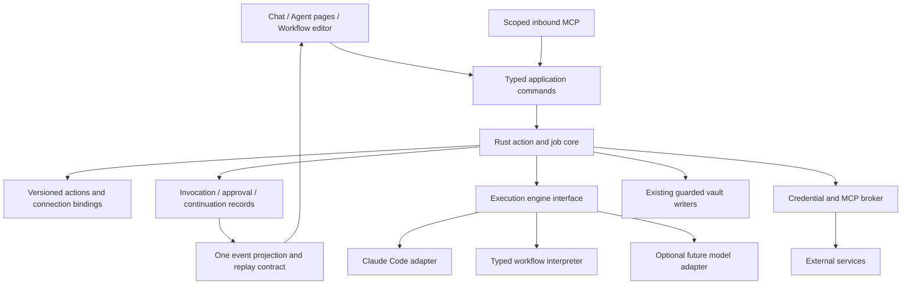

# n8n comparison: actions, MCP, agent execution and a durable chat experience

Review date: 2026-10-22. Documentation only; no application or reference source was changed,
installed, executed or tested. Findings describe the local `docs/examples/n8n-master` snapshot,
whose root and CLI package manifests report **2.45.0**, rather than a claim about an available
cloud release. Test files were inspected as evidence of intended contracts, not run.

The most useful n8n lesson is that **chat, agents, workflows and integrations can share one
action execution system**. Cerebro currently has substantial pieces of that system, including
scoped MCP tools, receipted vault writes, durable wakes and a bounded event journal. Its largest
gap is the absence of an application-owned connection/action catalog and durable continuation
model spanning external actions, approvals and delegated work. Adding more chat components alone
will not close that gap. A Rust-owned implementation is a credible direction; a simultaneous
replacement of React, the CLI harness and all YAML is unnecessary to obtain it.

## Scope and an essential distinction

This snapshot contains two overlapping agent architectures. The workflow-oriented LangChain
`AgentToolV3` consumes model, memory, tool and output-parser connections. Its
`resolveSubAgentRequest` explicitly rejects human-approval nodes inside a child. Separately,
`packages/@n8n/agents` and `packages/cli/src/modules/agents` implement a newer agent runtime with
JSON configuration, provider adapters, delegated task identities, background jobs and checkpoint
storage. The newer host can supply suspend/resume/cancel hooks; capabilities vary by execution
context. Treating every n8n subagent as either approval-capable or approval-incapable would be
wrong.

Likewise, n8n's instance MCP server, workflow MCP Trigger and outgoing MCP clients are separate
surfaces. The inspected clients focus on tools. The instance server registers some resources,
including SDK/reference content; this is not evidence of a complete incoming/outgoing
resources-and-prompts product. The snapshot README's protocol-version assertions are not used
here as normative current MCP guidance.

The root [license](../../../examples/n8n-master/LICENSE.md) assigns ordinary source to its
Sustainable Use License, `.ee.` files/directories to the Enterprise License, and third-party
components to their own licenses. The newer agents package itself declares
`LicenseRef-n8n-sustainable-use`. This review recommends architectural adaptation and original
implementation, not copying a permissively licensed plugin SDK that the source does not offer.
Observed features also depend on configuration, credentials and optional services: Redis for
queue/multi-main operation, provider SDKs for models, vector stores for semantic retrieval, and
`isolated-vm` for custom agent code. Source presence does not prove availability in every edition.

## Current Cerebro baseline, including M91

M91 is an in-progress working-tree implementation, not a completed baseline simply because its
plan exists. At inspection, the following were present:

- Rust `agent/mod.rs:1883` supplies explicit `--tools`; `InitGate` starts at line 3075;
  `spawn_run` applies subagent environment caps at line 2590.
- `agent/fold.rs:258` has per-parent sub-folds, session-file merging and subagent lifecycle
  events. Tests at lines 3732, 3914 and 3996 cover live/replay projection, parent-turn isolation
  and child-error attribution.
- `src/agent/types.ts` declares `Thinking`, `ToolResult` and `Subagent*`; presentation components
  exist under `src/components/ai/`.
- `shared/policy/subagents.v1.json` currently contains the CLI version and four environment
  caps. It does not yet contain the plan's presets, settings or seated environment. The inspected
  `src/agent/transcript.ts` still handles `ThinkingDelta` without the complete planned ordered
  parts/subagent projection. `agent/mod.rs` does not yet have the planned `--agents`,
  `--forward-subagent-text` and composed subagent-prompt path.

Consequently, credit M91's concrete policy/fold/component work, but do not schedule an expansion
on the assumption that branching, attachment flow, context display, worker presets and every
surface integration are already complete. Recheck the working tree before implementation;
these observations are a dated snapshot and not a judgment on work continuing elsewhere.

Existing foundations to retain are `connectors.rs` machine approval fingerprints and strict
per-run selection; `client_access.rs` inbound personal tokens; `interaction.rs` explicit
waiting/answering/answered transitions; `runtime/wakes.rs` transactional admission and claims;
`agent/journal.rs` bounded sequence replay and explicit gaps; and the distinction between
conversation history, operational state and verified knowledge.

## Ranked findings and proposed work

Effort is an initial estimate in engineer-weeks for one experienced contributor, including
targeted verification. Rows overlap and should not be summed into a promised delivery date.

### N1 — P0: Make a connection a product object, with actions below it

**Evidence.** n8n separates `ICredentialType` (`workflow/src/interfaces.ts:438`) from node
descriptions (`:3198`), versions nodes, supplies credential tests, and turns eligible nodes into
agent tools. Its newer agent config resolves credentials and tools through injected interfaces
(`from-json-config.ts:105–163`). Cerebro's `connectors.rs:1–33` and
`ConnectorSettings.tsx:76–90` primarily describe server configuration forwarded to Claude Code;
`AgentProperties.tsx:73–80` offers connector-wide tool groups.

**Adapt.** Introduce `Connection`, `AccountBinding`, `ActionDefinition` and `ActionInvocation`.
Actions need stable IDs, schema versions, input/output schemas, account identity, effect class,
timeouts, pagination and cancellation capabilities. A provider may expose native HTTP actions,
MCP tools, or both. One connection screen should show its accounts, reachable capabilities,
authorization state and last successful check. Keep a custom-server path for advanced users.

**Failure contract.** Distinguish unauthenticated, expired, unavailable, configured-but-disabled
and connected-with-no-actions. An action/schema change must not silently widen an agent's
grant. Existing connection fingerprints remain useful for local executable/server changes.

**Accept / effort.** Two accounts for one service remain distinguishable in chat and history;
an agent can receive one action without every tool from that server; credential expiry produces
a repair link. 3–5 weeks. Depends on a connection identity/schema decision, not a workflow canvas.

### N2 — P0: Own credential references and account lifecycle in Rust

**Evidence.** n8n's `core/src/credentials.ts` encrypts/decrypts credential payloads;
`credentials-tester.service.ts` executes provider-defined tests. The agent MCP factory derives
auth through a credential provider, refreshes OAuth credentials, and keeps authentication-domain
policy separate from tool runtime. Cerebro `connectors.rs:110–171` explicitly stores owner-only
plaintext header/env values, while OAuth sign-in remains CLI-oriented. The distinction is
already documented honestly.

**Adapt.** Put stable secret references in portable definitions and resolved credentials in an
OS-backed secret store through a Rust broker. Keep user-supplied MCP compatibility while adding
first-class account connect/test/reconnect/revoke. Separate model credentials, integration
credentials and inbound Cerebro client tokens; none should accidentally authorize another class.
This is a proposed expansion of the current “Cerebro holds no credentials” contract.

**Failure contract.** Refresh failures must not retry with another account or downgrade to
anonymous traffic. Revocation invalidates future dispatch and cached clients. Export/import
shows unresolved references instead of exporting secret values.

**Accept / effort.** A cloned vault requests local account binding; changing an account during a
pending approval invalidates that approval; logs and agent context contain references and safe
labels only. 3–6 weeks, parallel with N1 after interface agreement. Do not copy server-wide
encryption-key assumptions into a desktop credential store.

### N3 — P0: Let Cerebro broker MCP, rather than only forward configuration

**Evidence.** n8n's `nodes-langchain/nodes/mcp/shared/runtime.ts:93–205` connects, discovers,
filters, wraps and closes a toolkit; its tests cover cancellation before/during connection,
tool selection and structured results. The newer agent `mcp-client-factory.ts:111–149` separates
credential/OAuth ownership from a lazy client and connection warnings. Cerebro's outbound path
builds CLI MCP configuration; inbound `mcp.rs:1469–1482` dispatches initialize, ping and tools,
and returns method-not-found for other methods.

**Adapt.** Build a Rust MCP connection manager behind N1: discovery snapshots, schema-change
diffs, explicit tool allowlists, lazy connection, cancellation, bounded responses and visible
partial discovery. Serve granted external tools to the CLI through Cerebro's broker so the
action ledger observes the actual call. Preserve direct compatibility mode during migration.
Add resources/read and prompt selection as separately designed capabilities; resource content
and prompt text should carry source identity and never become higher-priority instructions.

**Failure contract.** A broken server may leave other servers usable, but the run must say which
capabilities are missing. Pagination, timeouts and a cancelled transport must not look like a
successful empty result. Inspect output-schema changes before reuse of stored workflows.

**Accept / effort.** Two servers with identical tool names stay distinct; discovery cancellation
closes transport; a selected read-only tool cannot call a hidden mutation; resource failure is
visible. 4–7 weeks. Prefer a protocol-library spike against the chosen pin before estimating all
transport/auth interoperability work.

### N4 — P0: Give every external action an invocation record and honest retry policy

**Evidence.** n8n's workflow engine has bounded `retryOnFail` handling at
`workflow-execute.ts:1835–1850`, also present in `WorkflowToolService.ts:95–109`.
`execute-workflow.tool.ts:95–103` marks execution as potentially destructive and non-idempotent.
`job-processor.ts:149–154` explicitly refuses a crashed execution that queue/recovery mechanisms
may enqueue again. None of this proves exactly-once external effects. Cerebro's receipted vault
writes, call approvals and run outcomes provide strong local foundations but do not amount to
an external action result ledger.

**Adapt.** Record prepared, awaiting-approval, dispatched, succeeded, failed, cancelled and
outcome-unknown invocations. Store the definition version, canonical argument digest, account,
run/child identity, attempt number, safe output summary and remote receipt. Retry reads and
provider-idempotent operations according to declared rules. Offer reconciliation for an
ambiguous mutation, using provider request IDs or a follow-up read when available.

**Failure contract.** Network timeout after dispatch means the effect may have happened.
Cancellation does not prove rollback. A batch is allowed to be partially completed and must say
which items need reconciliation. Compensation is a separate action, not local Undo.

**Accept / effort.** Simulate a successful remote write with a lost response: reopening must
show unknown outcome and must not automatically send again. Repeating an approval cannot create
a second local dispatch claim. 3–5 weeks; prerequisite for broad external-write workflows.

### N5 — P0: Extend approval from a live card to a durable continuation

**Evidence.** `N8NCheckpointStorage` strips binary file data before persistence, checks execution
ownership under transaction (`:131–153`), distinguishes expired/already-handled state
(`:162–179`), and supplies `claimForResume` (`:183–195`). Cerebro `interaction.rs:747–843`
keeps its interactive book in memory, with transcript deferral recovery; its registered and
answering states are already carefully distinguished. Durable page proposals are another
existing mechanism, not a general serialized agent continuation.

**Adapt.** Define a durable approval object tied to an invocation and continuation ID, recording
the exact input/account/grant version the person saw. Resume through one Rust claim. Present a
single inbox of waiting actions reachable from chat and run details. Keep approvals optional
where the owner's action policy already permits execution; do not require a click for every read.

**Failure contract.** Approval expiration, changed arguments, removed credentials, cancelled
parents and unavailable execution engines need separate outcomes. A child requiring approval
must bubble to a host that can actually suspend and resume it; otherwise refuse with a clear
capability explanation before the effect.

**Accept / effort.** Quit while waiting, reopen and resolve exactly that request once; approve
simultaneously from two surfaces and obtain one local winner; expired requests stay legible.
3–5 weeks, dependent on N4 and an execution-engine continuation contract.

### N6 — P1: Add a small typed workflow engine with versioned definitions

**Evidence.** n8n `WorkflowEntity` stores nodes/connections/settings as JSON, separate current
and active version IDs (`:52–59`, `:103–111`); `WorkflowHistory` stores versioned graphs.
`WaitTracker:162–205` resumes persisted execution data and its saved workflow definition,
restoring acting identity rather than loading an arbitrary newly edited graph. Cerebro's
`runtime/wakes.rs:1–31` already durably admits and claims triggers; `followups.rs` books later
runs, and Agent pages hold instructions/grants. These are not yet a typed multi-step workflow.

**Adapt.** Begin with trigger → read/query → bounded transform → condition → action → wait/approve
→ result. Give every step an input/output schema and store the run's immutable definition hash.
Author through a simple list/inspector and a page's natural-language overview. Add a graph only
when branching/joins become difficult to understand in the list. Reuse the same actions in chat,
agents, workflows and inbound MCP.

**Failure contract.** A paused run resumes its original definition or requests an explicit
migration. A failed branch, skipped branch and no matching records are distinct. Desktop sleep
and app closure must appear as waiting/offline; a local engine cannot promise always-on delivery.

**Accept / effort.** Run a saved three-step workflow, pause it, edit its draft and resume the old
version predictably. Duplicate triggers do not duplicate an admitted live job. 6–10 weeks after
N1/N4/N5. Defer Redis workers and unrestricted user-code transforms initially.

### N7 — P1: Make delegated work a typed child task, beyond nested trace styling

**Evidence.** The newer SDK's `delegate-sub-agent-tool.ts:96–188` owns task schemas,
instructions, bounded concurrency and lifecycle events. `sub-agent-task-path.ts:1–36` separates
task identity from memory/session identity. The host offers foreground and optional background
runners plus paired resume/cancel hooks. Legacy `resolveSubAgentRequest.ts:47–59` rejects HITL
inside a workflow subagent, while the newer MCP factory's `nonInterrupting` context prevents
approval-required tools where checkpointing is unavailable.

**Adapt.** Complete M91's research worker first. Then add Rust-owned child task records with
parent ID, requested objective, input/context references, output schema, grant subset, budget,
deadline and result status. Offer read-only researcher, reviewer and planner presets; later
allow an Agent page to be invoked as a child under an explicit intersection of parent authority
and child configuration. Foreground CLI workers and independent Cerebro jobs must remain
distinct execution modes.

**Failure contract.** Child failure must not automatically fail the parent, nor be summarized as
success. Parent cancellation must name children still settling. Background launch returns a
receipt; completion is a later recorded event. Unknown child usage is not zero.

**Accept / effort.** Two children can finish out of order with stable attribution; one denial
does not hide another success; grants never expand through delegation; required approval
survives host restart. 4–7 weeks after M91, N4/N5; background execution adds 3–5 weeks.

### N8 — P1: Make chat recovery, revisions and branch identity first-class

**Evidence.** n8n `ChatHubMessage` records previous/retry/revision message IDs and execution
identity (`chat-hub-message.entity.ts:97–138`). `ChatStreamStateService:14–62` has sequence
numbers and bounded reconnect buffers, with in-memory versus Redis topology; its tests include
buffer limits and replay after a cursor. Cerebro `conversations.ts:6–27` retains a localStorage
cache of 30 threads with CLI transcript recovery, and `agent/journal.rs` already exposes explicit
gaps. M91 is extending the single fold/reducer model.

**Adapt.** Move conversation metadata and stable message/branch identity into Rust operational
storage, while treating CLI transcript data as engine evidence. Preserve one projection for
live and replay events. Add thread search, explicit restore status, branch provenance and a
clear distinction between retrying generation and repeating an external action. Do not add a
second incompatible transcript store merely to copy n8n's schema.

**Failure contract.** A missing CLI transcript is unavailable, not an empty conversation.
Reconnection cannot duplicate a tool result. Branching preserves file/external effects already
performed; it changes conversation ancestry only.

**Accept / effort.** Recover a conversation after localStorage eviction, truncate the live
journal mid-child, and obtain the same visible messages/actions after replay. Retry cannot
silently resubmit a prior remote mutation. 3–5 weeks after the M91 projection is complete.

### N9 — P1: Put tools, accounts, context and outputs directly into chat

**Evidence.** n8n `ChatPrompt.vue:193–206` toggles per-session/per-agent tools; its prompt
callouts expose missing credentials. `ChatHubToolService:66–119` enforces ownership and limits
chat parameter expressions. `ChatArtifactViewer.vue:58–104` supplies an artifact selector,
download and HTML `iframe sandbox=""`. Cerebro has tool/grant settings, context chips, page
navigation and change cards, while M91 supplies presentation pieces and planned attachments.

**Adapt.** Add a composer capability picker showing action count, account and availability; a
context inspector explaining attached/omitted sources; and an output shelf with versioned
artifacts linked to the producing run. Each artifact should offer Open, Save to vault, Compare
or Export according to type. Prefer existing page/sheet/canvas viewers over a parallel editor.
The main response should summarize outcome and pending decisions; details expand beneath it.

**Failure contract.** A preview is not a saved file. A failed attachment import keeps the draft
and explains what was omitted. Artifact HTML requires a deliberate isolated preview/network
policy; empty iframe sandbox alone is not an all-purpose network policy.

**Accept / effort.** Keyboard-only selection works in floating/panel/canvas presentations;
disabled capabilities explain how to repair them; reopening artifacts retains identity and
versions. 3–5 weeks, using M91 components and N1/N8 data.

### N10 — P1: Treat retrieved evidence as addressable passages with lifecycle state

**Evidence.** The newer n8n `knowledge-retriever.ts:12–40` offers find/search/read separately;
`agent-knowledge-retrieval.ts:135–180` accepts bounded line ranges, with citations on returned
passages. Chat Hub also has a different vector-index path with indexing/indexed/error states
(`chat-hub-agent.service.ts:373–406`). Its cleanup can continue after failed embedding deletion,
which should not be copied as proof of complete erasure. Cerebro's `vault/corpus.rs:1–36`
provides a stat-keyed text cache with explicit size caps, and its knowledge ledger preserves
evidence/verification distinctions.

**Adapt.** Give retrieved snippets source identity, content hash/version, passage locator,
retrieval time and truncation state. Citation clicks should open the passage and indicate when
the source has changed. Let agents attach scoped evidence collections without treating uploaded
or retrieved text as verified knowledge. Add semantic retrieval only after a benchmark shows
where lexical/path/title retrieval fails; embeddings remain rebuildable derived state.

**Failure contract.** Stale, unavailable, filtered and no-match sources differ. Revoked access
must remove sources from retrieval immediately even if background cleanup remains pending.

**Accept / effort.** A moved or edited source resolves with an honest status; an excluded file
cannot return via cached semantic results; evidence citations survive chat replay. 3–5 weeks.

### N11 — P1: Invest in executable agent scenarios, not only stream fixtures

**Evidence.** n8n's newer SDK contains recorded integration cases for approval suspension,
denial without handler execution, delegated lifecycle chunks, model iteration limits and crash
resume. `runtime/__tests__/agent-runtime.test.ts:4747` and `:4791` check bounded child batches;
workflow tests exercise nested tools and continuation. Cerebro's fold fixtures and policy
goldens are valuable but primarily prove transport/policy contracts; M91.R live recordings are
still called out separately in the plan.

**Adapt.** Create scenario evaluations for user-visible outcomes: research with conflicting
sources; draft then explicitly send; account expires mid-workflow; child requests approval;
crash after remote dispatch; structured result cannot parse; cancelled parent with active
child. Inject model/MCP/action implementations so ordinary tests need no external credentials.
Keep a small separately invoked real-provider/CLI conformance suite.

**Failure contract.** Passing an evaluation requires recorded evidence of action outcome and
correct refusal/uncertainty, not matching a fluent final paragraph. “Manual test” must not
implicitly mean a harmless dry run: n8n's execute-workflow schema explicitly permits live
external services in manual mode.

**Accept / effort.** Every expansion above adds at least one fault-injected end-to-end scenario
and one task-success check. 2–4 weeks initially, then part of each feature rather than a final phase.

### N12 — P2: Separate Rust ownership from the choice of YAML replacement

**Evidence.** n8n's newer `from-json-config.ts:163–174` builds a live runtime from declarative
JSON without evaluating source strings. `agent-document.ts` separates API documents from stored
skill references; config updates use a base hash (`agents-config.controller.ts:86–106`). Its
custom-code path separately invokes V8 isolates (`agent-secure-runtime.ts:18–33`). This is a
TypeScript system, not evidence that a Rust UI is required. Cerebro already parses and writes
YAML in Rust (`vault/parse.rs:1–80`, `vault/write.rs:995–1030`), with scanner/type/relation rules
depending on that carrier.

**Adapt.** Make Rust the authority for action schemas, workflow evaluation, credentials, jobs,
approvals and metadata validation; expose typed view models to React. For executable agent and
workflow configuration, prefer a versioned JSON document with Markdown instruction text or
references. For ordinary page metadata, compare JSON sidecars, an embedded JSON carrier and a
SQLite authority explicitly. The last option changes the files-first product contract most.
Replacing YAML with another syntax alone does not resolve identity, schema evolution or
concurrent writes.

**Failure contract.** Migration must preserve unknown metadata, dates, relations, provenance,
file identity and malformed-but-recoverable originals. Multiple writers must not leave Markdown
and a sidecar disagreeing. Dual read is useful during transition; indefinite dual authority is not.

**Accept / effort.** A representative vault migrates with a deterministic manifest, backups,
conflict report and rollback; scan/query/grant results remain equivalent. 2–3 weeks for an ADR
and corpus prototype, then 6–12+ weeks for a chosen carrier migration. Defer full native UI
replacement until an isolated editor/accessibility prototype establishes a concrete advantage.

## Proposed architecture and sequence



Sequence the work as a capability expansion, not a rewrite release:

1. **Finish and validate M91**, establishing which chat and child-worker paths actually ship.
   Agree on Rust-owned IDs and event contracts. Start N11 scenarios immediately.
2. **Connections and actions:** N1/N2/N3 with N4. Deliver three end-to-end services selected from
   the owner's real use, including a read action, a draft action and an explicitly dispatched
   mutation. Measure connection success, repair success and task completion.
3. **Durable work:** N5 and a small N6 interpreter. Add N7 foreground task records, then expand
   to background children only when restart/cancel/approval behavior is proven.
4. **Chat investment:** N8/N9/N10 progress alongside the core as their contracts stabilize.
   Validate usefulness with complete journeys, not isolated component screenshots.
5. **Storage evolution:** decide N12 with real vault samples. New workflow definitions can use
   JSON before any page-format migration. A wholesale UI migration is a separate decision.

Transfer versioned definitions, explicit action boundaries, context-specific child capability,
checkpoint ownership and outcome-oriented scenarios. Adapt server topology and credential
storage to a local application. Defer a marketplace, general code execution, multi-main queues
and an enormous node canvas. Avoid both copying n8n's multiple overlapping agent models and
letting the CLI's private session format become the long-term source of every Cerebro concept.

## Source map and snapshot fingerprints

All n8n paths below are under `docs/examples/n8n-master/`; all Cerebro paths are at repository
root. Section references include line anchors from the inspected snapshot; these may move as
working-tree work continues.

| Area                             | Source entry points                                                                                                                                                                                                                                                                                                                                                                                                                                                                                                                                                                                                                                                                                                            |
| -------------------------------- | ------------------------------------------------------------------------------------------------------------------------------------------------------------------------------------------------------------------------------------------------------------------------------------------------------------------------------------------------------------------------------------------------------------------------------------------------------------------------------------------------------------------------------------------------------------------------------------------------------------------------------------------------------------------------------------------------------------------------------ |
| Node/credential contracts        | [interfaces.ts](../../../examples/n8n-master/packages/workflow/src/interfaces.ts), [credential test service](../../../examples/n8n-master/packages/cli/src/services/credentials-tester.service.ts), [credentials](../../../examples/n8n-master/packages/core/src/credentials.ts)                                                                                                                                                                                                                                                                                                                                                                                                                                               |
| MCP client/server                | [toolkit runtime](../../../examples/n8n-master/packages/@n8n/nodes-langchain/nodes/mcp/shared/runtime.ts), [runtime tests](../../../examples/n8n-master/packages/@n8n/nodes-langchain/nodes/mcp/shared/runtime.test.ts), [agent MCP factory](../../../examples/n8n-master/packages/cli/src/modules/agents/json-config/mcp-client-factory.ts), [instance service](../../../examples/n8n-master/packages/cli/src/modules/mcp/mcp.service.ts)                                                                                                                                                                                                                                                                                     |
| Workflow state                   | [workflow entity](../../../examples/n8n-master/packages/@n8n/db/src/entities/workflow-entity.ts), [history](../../../examples/n8n-master/packages/@n8n/db/src/entities/workflow-history.ts), [wait tracker](../../../examples/n8n-master/packages/cli/src/wait-tracker.ts), [wait tests](../../../examples/n8n-master/packages/cli/src/__tests__/wait-tracker.test.ts), [execution engine](../../../examples/n8n-master/packages/core/src/execution-engine/workflow-execute.ts), [job processor](../../../examples/n8n-master/packages/cli/src/scaling/job-processor.ts), [MCP execution tool](../../../examples/n8n-master/packages/cli/src/modules/mcp/tools/execute-workflow.tool.ts)                                       |
| Delegation and approval          | [new delegation tool](../../../examples/n8n-master/packages/@n8n/agents/src/runtime/tools/delegate-sub-agent-tool.ts), [task identity](../../../examples/n8n-master/packages/@n8n/agents/src/runtime/tools/sub-agent-task-path.ts), [checkpoint storage](../../../examples/n8n-master/packages/cli/src/modules/agents/integrations/n8n-checkpoint-storage.ts), [legacy child resolver](../../../examples/n8n-master/packages/@n8n/nodes-langchain/nodes/agents/Agent/agents/ToolsAgent/V3/helpers/resolveSubAgentRequest.ts), [SDK runtime tests](../../../examples/n8n-master/packages/@n8n/agents/src/runtime/__tests__/agent-runtime.test.ts)                                                                               |
| Chat                             | [message identity](../../../examples/n8n-master/packages/cli/src/modules/chat-hub/chat-hub-message.entity.ts), [stream state](../../../examples/n8n-master/packages/cli/src/modules/chat-hub/chat-stream-state.service.ts), [stream tests](../../../examples/n8n-master/packages/cli/src/modules/chat-hub/__tests__/chat-stream-state.service.test.ts), [tool service](../../../examples/n8n-master/packages/cli/src/modules/chat-hub/chat-hub-tool.service.ts), [composer](../../../examples/n8n-master/packages/frontend/editor-ui/src/features/ai/chatHub/components/ChatPrompt.vue), [artifact viewer](../../../examples/n8n-master/packages/frontend/editor-ui/src/features/ai/chatHub/components/ChatArtifactViewer.vue) |
| Knowledge                        | [retriever interface](../../../examples/n8n-master/packages/cli/src/modules/knowledge/knowledge-retriever.ts), [passage schemas](../../../examples/n8n-master/packages/cli/src/modules/agents/agent-knowledge-retrieval.ts), [Chat Hub indexing](../../../examples/n8n-master/packages/cli/src/modules/chat-hub/chat-hub-agent.service.ts)                                                                                                                                                                                                                                                                                                                                                                                     |
| Configuration/runtime separation | [JSON builder](../../../examples/n8n-master/packages/cli/src/modules/agents/json-config/from-json-config.ts), [document boundary](../../../examples/n8n-master/packages/cli/src/modules/agents/json-config/agent-document.ts), [config controller](../../../examples/n8n-master/packages/cli/src/modules/agents/agents-config.controller.ts), [isolated custom code](../../../examples/n8n-master/packages/cli/src/modules/agents/runtime/agent-secure-runtime.ts)                                                                                                                                                                                                                                                             |
| Cerebro comparison               | [connectors](../../../../src-tauri/src/connectors.rs), [connector UI](../../../../src/app/ConnectorSettings.tsx), [Agent properties](../../../../src/library/AgentProperties.tsx), [MCP](../../../../src-tauri/src/mcp.rs), [interaction](../../../../src-tauri/src/agent/interaction.rs), [wakes](../../../../src-tauri/src/runtime/wakes.rs), [journal](../../../../src-tauri/src/agent/journal.rs), [conversations](../../../../src/agent/conversations.ts), [fold](../../../../src-tauri/src/agent/fold.rs), [metadata parser](../../../../src-tauri/src/vault/parse.rs), [vault writer](../../../../src-tauri/src/vault/write.rs)                                                                                         |

SHA-256 anchors captured during review:

```text
n8n package.json
48664c390ad7dbc74bb0ddae0bdd3b0c85c2fbeddfcc4c888f9b1e8733e3e3ff
n8n packages/@n8n/agents/src/runtime/tools/delegate-sub-agent-tool.ts
fe4e8d03c8ff6b2d36f309494fb2fe2626010e2002fffc498d86b6ec17651ffc
n8n packages/cli/src/modules/agents/integrations/n8n-checkpoint-storage.ts
a5a6fa698ea0ad4d717910a74b5b7da12839f695f5e3eb7f33cfbea9bf05f255
Cerebro shared/policy/subagents.v1.json
071375b0c8c84432dad12667c132025e8ea8a48ec07c0009d5e866051eceb721
Cerebro src/agent/transcript.ts
f1b8bef86568e7eff068d94f41ae2af6cc55296bac199a76d1f1ad098f73288a
```
