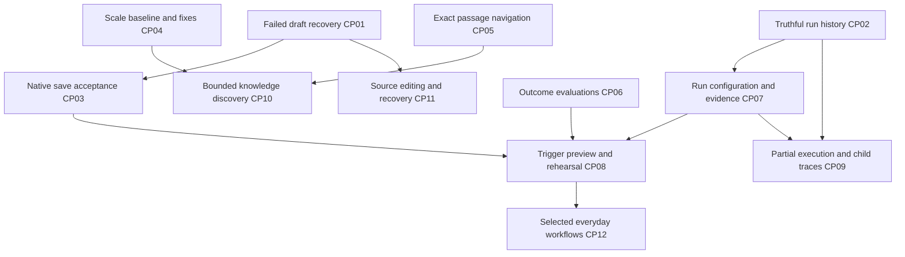

# Cerebro strengthening plan from five reference repositories

Date: 2026-10-22. Status: completed comparative review and proposed implementation plan. This plan proposes work and does not authorize or claim implementation.

Cerebro's largest opportunity is to make its existing guarantees easier to use, verify, and recover from. Its guarded writers, portable knowledge records, typed policy, durable agent admission, and source-aware retrieval are substantial foundations. The next investment should make everyday work dependable at larger scale, connect search results to exact evidence, and let a person understand an agent before and after it acts.

Start with **failed-save recovery, truthful run history and CLI readiness, the outstanding native acceptance, and the measured table performance gap**. Follow with exact-passage navigation, agent outcome evaluations, historical execution manifests, trigger preview and carefully isolated rehearsal, and context inspection. Add knowledge discovery and capture conveniences after those foundations. A second shell redesign or a replacement workflow platform would consume effort without addressing the most concrete weaknesses found here.

## Review scope and evidence

The comparison covers engineering practices, architecture, UX/UI, agentic workflows, and knowledge/retrieval in each of the five requested local snapshots. Repository dossiers contain source locations, comparisons against current Cerebro code, individual findings, and acceptance criteria:

| Reference    | Detailed review                                                     | Most useful direction                                                                           |
| ------------ | ------------------------------------------------------------------- | ----------------------------------------------------------------------------------------------- |
| Macro        | [Macro dossier](2026-10-22-reference-review/macro.md)               | Search and conversation continuity, observable delegated work, explicit architectural contracts |
| Morrow       | [Morrow dossier](2026-10-22-reference-review/morrow.md)             | Save recovery, passage navigation, contextual connections and a source-editing escape hatch     |
| Tolaria      | [Tolaria dossier](2026-10-22-reference-review/tolaria.md)           | Files-first scale, keyboard workflows, onboarding and external-tool ergonomics                  |
| Thought Desk | [Thought Desk dossier](2026-10-22-reference-review/thought-desk.md) | Real workload stress tests, bounded rendering and coherent daily workflows                      |
| Activepieces | [Activepieces dossier](2026-10-22-reference-review/activepieces.md) | Rehearsal, execution history, explicit recovery and outcome evaluations                         |

The Cerebro baseline is HEAD `23479518c2827d361c9c970abfac8245f9d84600` plus the working tree inspected on this date. There were **618 preexisting changed paths**, including the M84–M90 polish implementation. A HEAD-only comparison would incorrectly classify much of the current UI as missing. Reference directories are ignored study material, not project code; their packages and tests were inspected without running or modifying them. Local snapshot versions are not asserted to be current upstream releases.

Five repository specialists covered the 25 repository/topic combinations; three independent reviewers then challenged architecture, agent/knowledge, and UX claims. The [review packet index](2026-10-22-reference-review/README.md) contains the coverage matrix, validation memos and disposition of all 46 ranked findings. Those findings are consolidated into the 13 packages below, with optional extensions kept separate. The review does not equate “more features” or larger repositories with better architecture.

Evidence is classified as **source-confirmed**, **recorded measurement**, **capability/depth gap**, or **validation gap**. A missing path in a review is not proof that an entire repository lacks a capability. Concrete negative findings below identify the inspected execution or presentation seam. Historical test results remain historical; this documentation review does not claim a fresh application test pass or a live native walkthrough.

The existing [M84–M90 implementation record](2026-10-17-m84-m90-implementation-record.md) governs what is implemented versus still awaiting acceptance. The existing [Macro roadmap decisions](2026-10-12-macro-port-roadmap.md) and [knowledge architecture](convergent-intelligence-overhaul.md) remain in force. Suggested changes below preserve their boundaries unless explicitly identified as a separate design decision.

During final review, a separate [M91 AI elements and subagents plan](2026-10-22-m91-ai-elements-and-subagents.md) appeared in the shared working tree, marked PLANNED. It overlaps CP07/CP09's context/trace presentation, child activity, and transcript boundaries. Coordinate those changes under one fold/reducer and shared presentation ownership; do not start a competing trace implementation from this plan. Its proposed work and reported probe observations are not treated here as implemented behavior or independently verified live evidence. The immediate save, history, readiness and performance findings remain applicable to the reviewed source.

## What Cerebro should keep

The references reinforce several choices Cerebro already makes well. These are constraints on the plan, not new backlog items.

| Existing strength                                | Current implementation                                                                                         | Implication                                                                                                                                                                                     |
| ------------------------------------------------ | -------------------------------------------------------------------------------------------------------------- | ----------------------------------------------------------------------------------------------------------------------------------------------------------------------------------------------- |
| Files and guarded knowledge remain authoritative | Markdown/Type documents, vault ledger, `vault/receipt.rs`, `ledger/`, `knowledge.rs`                           | Do not move user content into a database-owned workspace. Operational SQLite and disposable ledger projections keep their separate roles.                                                       |
| Guarded Cerebro mutation APIs                    | Path locks, hash checks for agent API calls, journaled batches, receipts, guarded inverse undo                 | New previews, source editors and link suggestions must reuse these doors. Approved direct CLI writes have a different, partially observed path; absence of a receipt is not proof of no effect. |
| Policy and cross-language contracts are data     | `shared/policy/`, `shared/schema/`, `shared/calendar/`, shared cases and digest tests                          | New run/rehearsal semantics must not become hand-copied Rust/TS policy.                                                                                                                         |
| Durable bounded agent work                       | `runtime/dispatch.rs`, `wakes.rs`, `followups.rs`, `pending_writes.rs`                                         | Improve inspection and recovery rather than replacing the scheduler.                                                                                                                            |
| Human decisions stay human                       | `agent/interaction.rs`, ask-first dispatch, Review, `ConceptReviewBar`                                         | Rehearsal never grants itself permission, and evaluations never verify knowledge.                                                                                                               |
| Retrieval is already substantial                 | `search.rs`, `vault/corpus.rs`, `retrieval/`, `assembly/`, concept graph                                       | Benchmark relevance and expose existing evidence before adding another retrieval backend.                                                                                                       |
| One stable interaction model                     | Pane claims, visit state, keymap, persistent assistant controller, shared transcript fold                      | Search destinations and child traces must not create duplicate editors or transcript parsers.                                                                                                   |
| Broad engineering defenses                       | Coverage ratchets, no-DOM engine check, IPC contracts, browser tests, state lab, Rust rails and release checks | Add missing failure scenarios and task outcomes; do not replace these with a superficial test checklist.                                                                                        |

Keep the 54 px rail, contextual sidebar, page anatomy, typography, themes and floating assistant already implemented. The references suggest improvements in continuity and feedback, not a reason to restart visual design. Keep Home pull-only, memory distinct from verified knowledge, imported text distinct from owner testimony, and mail draft-only.

## Priorities and sizing

P0 repairs a concrete reliability/truthfulness problem or closes a known acceptance gap. P1 improves a central journey on the existing architecture. P2 is a bounded extension whose value should be demonstrated before broad rollout. These priorities supersede individual dossier rankings when findings are combined.

Effort is a planning estimate for an engineer familiar with the affected code, including focused tests and review: S = 1–3 engineering days, M = 4–10, L = 11–20. Native access, unfamiliar formats and model variability can add elapsed time. Ranges below overlap in shared work; do not sum them as a delivery commitment. Final ownership is by code area, not by reference repository.

| ID   | Priority                | Deliverable                                           | Evidence classification                                          | Effort                            | Prerequisites                                         |
| ---- | ----------------------- | ----------------------------------------------------- | ---------------------------------------------------------------- | --------------------------------- | ----------------------------------------------------- |
| CP01 | P0                      | Retained failed drafts and acknowledged saves         | Source-confirmed missing retry path; runtime loss not reproduced | M                                 | Failure fixture first                                 |
| CP02 | P0                      | Correctly scoped history and explicit detail failures | Source-confirmed defects                                         | S/M                               | Scope contract for agents versus constructs           |
| CP03 | P0                      | Native and live CLI acceptance closure                | Explicitly recorded validation gaps                              | M, environment dependent          | CP01 for failed-save acceptance                       |
| CP04 | P0                      | Repeatable scale benchmark and usable large tables    | Recorded unmet performance target                                | L                                 | Baseline reproduction and accessible rendering design |
| CP05 | P1                      | Search and citations reveal the exact passage         | Source-confirmed navigation depth gap                            | M                                 | Shared location contract                              |
| CP06 | P1                      | Outcome evaluations for agents and retrieval          | Existing lower-level tests; missing product-level baseline       | M initial, ongoing                | Disposable fixtures and existing recording kit        |
| CP07 | P1                      | Historical run configuration and context inspection   | Existing receipts/manifests; presentation and coverage depth gap | M/L                               | CP02; bounded retention contract                      |
| CP08 | P1                      | Trigger preview and isolated agent rehearsal          | Missing combined product journey                                 | S/M preview, L isolated execution | CP06 and CP07; CP03 for live behavior                 |
| CP09 | P1                      | Explainable partial-run recovery and delegated traces | Existing execution core; observability depth gap                 | M/L                               | CP02, CP03, CP07                                      |
| CP10 | P1/P2                   | Contextual backlinks and bounded knowledge discovery  | Backlinks exist; snippet/mention depth gap                       | M                                 | CP05 and CP04 search measurements                     |
| CP11 | P1/P2                   | Productive source editing and conflict recovery       | Guarded rich editing exists; escape/recovery depth gap           | M/L                               | CP01; explicit byte/retention decisions               |
| CP12 | P2                      | Capture, recipe and connector workflow completion     | Targeted usability extensions                                    | M per selected slice              | Proven user journey, CP06/08 where agents run         |
| CP13 | P0 repair / P1 guidance | Honest CLI readiness and task-oriented product help   | Source-confirmed readiness defect; help depth gap                | S repair, M guidance              | Existing discovery and shared prompt contracts        |

### CP01 Retain failed drafts until a save is acknowledged

The current editor assigns `lastSaved` before its save callback settles and its flush only emits when a debounce timer is pending ([MarkdownEditor.tsx](../../../src/editor/MarkdownEditor.tsx), lines 671–720). The page owner catches a rejected save and emits a failed state/toast without retaining a retry payload at that path ([NoteBodyEditor.tsx](../../../src/editor/NoteBodyEditor.tsx), lines 299–332). The existing failure test verifies the toast. The quit controller counts failures since quit began, which leaves a prior unresolved failure as a specific case to prove ([quit.ts](../../../src/app/quit.ts), lines 167–188).

This is a source-confirmed missing recovery path, not a claim that a native data-loss incident was reproduced. Morrow supplies a useful contrasting invariant: failed IDs return to the dirty set, and a retry writes the latest document rather than a stale queued copy. Its test changes content between failure and retry.

Implement in three small changes:

1. Add a regression scenario for autosave failure, successful writer recovery, and Save without further typing. Include a failure that predates quit, navigation, rename and assistant launch.
2. Separate the latest draft, in-flight generation and acknowledged disk generation. Return a typed internal save outcome while keeping human-facing store actions nonthrowing. Retain exact text after I/O failure and refuse to represent it as durable. Integrate unresolved failures into the existing flush/hold contract.
3. Add an accessible Retry action and a clear resolution path on navigation/quit. Retry transient I/O only under a bounded policy; policy refusals, deleted files and malformed inputs remain actionable refusals. Preserve the latest draft during mode changes and external reconciliation. Quit currently unmounts the shell before checking leave-triggered failures and explicitly notes that it cannot then preserve editor text. Settle before that unmount or retain the draft in an owner that survives it; a failure counter and a Retry button alone are insufficient. Preserve the existing bounded quit deadline and explicit quit-anyway semantics unless a separate change is justified.

**Exit:** a failed settled autosave can be retried without a keystroke; later edits win over older attempts; preexisting failed drafts remain visible and recoverable; a retained failure cannot be mistaken for a successful flush. Tests cover repeated failure, stale completion, pane parking, outside edits, rename, vault switch and quit. Human last-write-wins remains D2's deliberate rule. Any persistent crash-draft store is a separate retention design, not an implicit addition to this fix.

### CP02 Make run history complete enough to tell the truth

`AgentRunHistory` requests the latest 200 global runs, then filters by actor and may say “No runs recorded” ([AgentRunHistory.tsx](../../../src/status/AgentRunHistory.tsx), lines 37–75). Both the Macro and Activepieces reviews found this independently. Rust already supports actor and vault filters before `LIMIT` ([fleet.rs](../../../src-tauri/src/runtime/fleet.rs), lines 43–57 and 276–308).

Send the intended vault and actor filters first. Then add keyset pagination using `(started_at, run_id)` plus a continuation indicator. Fetch bounded lineage separately so narrowing the roots does not discard other agents' child runs. Define construct pages' cross-vault behavior explicitly; ordinary agent records are vault-scoped.

Use the authoritative runtime vault identity, not a raw vault path substituted into `vault_id`. Carry the originating vault through every detail subsection and page link: `KnowledgeChanged` currently queries the active vault, and `PagesWritten` resolves relative paths there. Cross-vault history must resolve the recorded vault or show an explicit unavailable/switch action, never open a same-named page in the wrong vault. Child-hop buttons also need their selected detail mounted; the current panel is rendered only for the outer actor rows. These are part of correctness, not just pagination polish.

Keep the selected run identity separate from the detail read. Currently a failed request closes the detail, and an older response can overwrite a later choice. The knowledge subsection also collapses a rejected read into “not recorded” ([RunDetailPanel.tsx](../../../src/status/RunDetailPanel.tsx), lines 72–98). Use distinct loading, ready, unavailable and not-recorded values, local Retry, and request identity checks. `useContentSearch` already demonstrates a useful keyed-response pattern; do not add a query library solely for this repair.

**Exit:** an old run remains discoverable behind 250 newer unrelated runs; equal timestamps paginate correctly; matching actor names in different vaults remain separate; parent/child links survive pagination. A failed detail stays selected and explains its failure; retry repairs only that section; late responses cannot reopen the wrong run. Add the five required lab states for new reading sections.

### CP03 Close native and live CLI acceptance

M84–M90 records broad browser coverage but explicitly leaves native input, IME, VoiceOver, Finder drop, clipboard/dialogs, open policy/CSP and pending/failed-save quit outstanding. The earlier CLI approval seam also retains explicit live-evidence obligations. These are release-confidence gaps, not missing implementations.

Use a disposable vault and an isolated packaged build with recorded source/build/toolchain identity. Run a bounded acceptance matrix: edit and reconcile, save failure before quit, nonleading-H1 navigation, keyboard-only control use, VoiceOver, composition input, Finder attachment, native dialog cancellation, and external link/file policy. Separately exercise the user's CLI through allow, deny, edited input, invalid input, stale target, Stop during a decision, repeated click, missing hook, restart while waiting and vault switch. Sanitize retained CLI traces through the existing recording kit.

**Exit:** every case has an actual pass, a reproduced defect, or a named unresolved environment limitation. Packaging success does not count as native editing acceptance, and browser mocks do not count as CLI integration evidence. Resolve the observed `cgWindowNotFound` inspection limitation before relying on computer automation for this matrix. Stronger resume/rehearsal promises wait on their relevant live cases; independent correctness fixes can proceed.

### CP04 Make scale an explicit product contract

The existing production record measured p95 key-to-two-frame times of **398.8 ms at 1,000 records × 12 fields** and **1,376.2 ms at 1,000 × 24**. Navigation at 5,000 × 12 timed out; 5,000 × 24 was unmeasured after the bounded stop. These were unthrottled headless Chromium diagnostics on a shared machine, not native input-to-photon measurements. The proposed <100 ms input budget remains unmet. See the [method and retained results](../specs/2026-10-17-polish-implementation/data/performance/production-report.md).

Promote the retained benchmark into a repeatable engineering tool. Generate disposable corpora outside `demo-vault/`: 100/1,000/5,000 records, 12/24 fields, long and sparse values, relations/rollups, large documents and long transcripts. Record cold open, warm open, input, filtering, scroll, save-to-visible-update, memory and startup/corpus work separately. Include a 10,000-note search workload; page count is not the same as row count or payload size.

Profile before choosing a renderer. Compare cached derivations and narrower subscriptions first, then explicit paging or bounded row rendering. A virtualizer is a candidate, not the acceptance criterion. Preserve active-editor leases, exact rejected drafts, browser find or a clearly equivalent search path, keyboard End/range selection, offscreen announcements, wrapped row heights, frozen columns and Back-restored scroll. The previous `content-visibility:auto` experiment was removed because an offscreen row vanished from Chromium's accessibility tree; a faster number cannot excuse that regression.

**Exit:** repeat the original workload under declared hardware/build/load conditions; meet the retained 1,000-row input target without losing the correctness cases. Establish a measured 5,000-row usability target during the spike rather than inventing a current pass. Ship a bounded loading/paging behavior if an unbounded view cannot meet it. Keep noisy timing diagnostics out of normal unit tests; enforce stable, reviewed budgets on a suitable runner. Search optimization starts with cached per-file tokens/statistics under the existing disposable corpus contract. A persistent content index requires a separately justified architecture decision; the knowledge ledger's existing index is a different system.

Keep per-document cached tokens distinct from corpus-wide ranking statistics. BM25 document frequency must be computed for the effective readable corpus or keyed by that corpus; inaccessible documents must not alter scoped ranks or counts. Reuse frontend view-search haystacks across query keystrokes only if profiling shows material cost, with entry/schema/vault invalidation and identical match semantics.

Treat editor opening as a separate measured slice. Tolaria demonstrates bounded raw/parsed caches, foreground priority over prefetch, and cancellable progressive mounting. First measure parse, DOM application and ready-to-edit time independently. A cache covers closed clean documents, not an additional copy of live pane drafts, and is bounded by bytes, entry count, vault/path/content and parser version. Failed reads never stay cached. Progressive application may show early content, but the complete document must pass the existing carrier/round-trip checks before editing, autosave or undo is enabled. Test abort on navigation, title projection, metadata stability, reconciliation, loss warnings and quit during loading. Keep only measured improvements; do not introduce a second Markdown grammar or a stale startup snapshot by default.

### CP05 Open the exact evidence a result describes

Cerebro's ranker knows whether an excerpt came from a body line or a frontmatter field, but Quick Open opens only the path ([QuickOpen.tsx](../../../src/app/QuickOpen.tsx), lines 353–371). The person therefore finds the document and must find the fact again. Morrow and Macro both provide useful passage-navigation patterns.

Define one bounded, version-aware location descriptor for search hits, backlink snippets and citations. The ranker's location is internal today: the exported `VaultHit` contains path/title/type/parts, so this requires a Rust/IPC/mock contract extension as well as UI wiring. It should identify the file and distinguish a body passage from a property. Carry enough quote/context/hash information to detect a stale or ambiguous match; ephemeral editor block IDs alone are not durable evidence. Reuse the existing section-link reveal mechanism, one editor per file and pane navigation. Reveal once after readiness, highlight passively, and preserve the user's editing selection. A changed source falls back honestly to the page or nearby heading.

**Exit:** repeated phrases reach the scored occurrence; Unicode offsets, property hits, collapsed sections, nonleading title projection and lazy editors work; stale/removed targets never produce a false exact landing. Back restores the result query and prior place. Modified open focuses or opens the correct pane without a second writer. The read/navigation action writes no Markdown.

### CP06 Test task outcomes and retrieval usefulness

Cerebro already has adversarial policy evaluations, shared fixtures and sanitized CLI protocol recordings. Extend them with an end-to-end task corpus, drawing on Activepieces's separation of regression cases, capability experiments, deterministic assertions and calibrated judgments. Macro's task-dedup evaluation also illustrates the value of labeled relevance and judge-variance checks; it is not a reason to adopt its provider stack.

Start with 12–20 cases using synthetic files: capture and file a note; update a record; answer a question with accessible sources; surface contradiction and stale evidence; refuse to self-verify; honor a correction; stop on stale content; queue an unattended ask-first write; resume after denial; resist instructions embedded in imported content; handle an unavailable connector; produce a draft without sending mail. Add negative controls that deliberately violate each expected outcome.

Each fixture declares input files, user turns, allowed tools/effects, expected durable outputs and forbidden writes. Maintain two lanes: deterministic protocol replay in the normal gate, and repeated opt-in live runs through the user's own Claude Code authentication. Record model/CLI/policy identity, outcome dimensions, elapsed time and known/unknown cost. Human review or model judgment supplements exact checks; it cannot override a forbidden write or false verification. A skipped live case remains skipped.

For retrieval, label relevant source passages and counterevidence for exact wording, paraphrases, aliases, accent variants, long documents, imports, inaccessible sources and unanswerable questions. Measure source recall at the actual production limit, supported-answer rate, counterevidence coverage, scope leakage and latency. Distinguish “retrieval failed,” “retrieval exhausted,” and “the model ignored supplied evidence.”

**Exit:** versioned fixtures, reviewed labels, negative controls, a reproducible offline report and a repeated live baseline with variability. Zero scope leakage and forbidden effects are hard gates. Numerical quality thresholds follow the first labeled baseline; do not invent a meaningful percentage before the corpus exists. Embeddings, stemming or new ranking are subsequent experiments justified by observed misses.

### CP07 Show the configuration and evidence actually used

Two related facts need different presentations. An execution manifest explains the run's effective instructions, grants and environment. The existing working-memory manifest explains which evidence a synthesis was shown. Do not conflate them, and do not rebuild the latter.

At dispatch, retain a bounded operational manifest with agent/skill content identities and hashes, effective grant, policy digests, requested and observed model, observed CLI version, approved connector spec identities, cause and relevant context/assembly IDs. Exclude tokens, headers, bearer values, environment secrets and raw connector credentials. Keep existing waiting-write snapshots and approvals tied to their originating run. Historical configuration is evidence, not another editable agent record. Record only observable facts: inherited user settings and remote tool semantics may remain partly unknown, and a spec digest does not freeze a remote service. This improves explanation without promising deterministic execution replay.

Expose **Configuration used** in the existing Runs detail, with a comparison against current settings. Hashes identify bytes but cannot reconstruct missing bytes; if old instructions are unavailable, say so. Bounded exact-source retention requires an explicit privacy/retention design and should not silently become a transcript archive.

Expose **Why this evidence** from the same run/answer: evidence items, selection reasons, recorded source identities/versions, review/freshness state, exclusions/truncation and counterevidence disposition. The Rust [working-memory manifest](../../../src-tauri/src/assembly/manifest.rs) already enforces satisfied/exhausted/blocked retrieval intents and prevents quietly dropping accessible contradictions to fit a cap. It covers the ledger-derived assertion/concept evidence of an assembly, not every raw page or tool result an ordinary chat may see. The current run view mainly exposes assembly counts. Give users access to this existing proof rather than introducing a “confidence score,” and explicitly label ordinary chat context as a different, incomplete record.

Concept provenance is already discoverable through the source-count action in `ConceptReviewBar` and `KnowledgePanel` in Details. Reuse those entry points and the page's one full-height panel slot. The gap is continuity from an answer/run to its recorded evidence and exact source, not a missing concept-sources panel. A complete acceptance journey is ask → inspect evidence → open source and its review/version context → Back to the answer with the draft and reading position intact.

**Exit:** changing an agent after dispatch cannot rewrite its history; old runs show not recorded; missing historical bytes remain unavailable; revoked access is respected when evidence is reopened; manifest reads stay SELECT-only. A user can explain why a cited concept was present and why a requested source was absent without reading a raw JSON blob. Human verification remains a separate act.

### CP08 Preview triggers and rehearse without production effects

Start with a deterministic **Preview trigger** action on the Agent page. Select a sample page/event and an explicit clock, then show match or non-match, effective scope, pause/budget constraints, and whether a model condition would still need checking. Use the same authoritative admission logic and shared cases as production. A preview does not reserve a lease, consume a wake, book a followup or run a connector.

Next consider a limited read-only instruction test, clearly labeled as such and subject to its actual tool boundary. A full rehearsal can follow only when every tool has an explicit disposition in an isolated execution environment: simulated read/write, refused, or unavailable. Disposable copied files or a distinct sink that cannot mint production receipts are necessary ingredients, not sufficient isolation. Claude Code also has built-in filesystem/shell tools and inherited configuration/connectors; current scope restrictions are not an OS sandbox. Prove the child-process filesystem, configuration, network and tool boundary with adversarial tests, including absolute paths and inherited servers. Disable shell and external mutations, and prevent real wake/followup creation. If that boundary cannot be demonstrated with the supported CLI/runtime, ship deterministic preview and defer live rehearsal. A reference product's Test button may call real services; Cerebro must define its own promise.

Return proposed diffs, expected approvals, refused capabilities, observed cost and limitations beside the agent draft. Applying a useful result is a separate existing human write, revalidated against current bytes. Do not claim that a passing rehearsal predicts every nondeterministic production run.

**Exit:** adversarial calls cannot reach the real vault, runtime scheduler, shell or outside mutation tools; cancellation cleans up; preview and real trigger evaluation agree; unsupported behavior is visible. The current Agent draft-on-Done rule remains intact. The product flow becomes draft → preview → inspect → enable → run → inspect, using the current Agent page and Runs tab.

### CP09 Explain partial execution before offering another attempt

The runtime already has leases, wake deduplication, conservative recovery and interrupted-write handling. The missing experience is a concise explanation of what happened when a run stops partway through. “Retry” currently re-sends the prior question; that is not a durable step checkpoint.

Present recorded writes, approvals, surviving session availability, known failures and unknown outside effects before a consequential rerun. Name the action accurately: ask again, continue an available session, or start a new run from a reviewed state. Record the new run's relation to the prior one. Never infer that no result means no side effect; foreign tools without idempotency/receipt contracts remain uncertain.

Add bounded delegated activity where the CLI actually exposes it. Macro folds nested agent tools into a child trace; Cerebro deliberately drops sidechain events and documents that CLI Task-subagent writes may be unseen. Extend the existing fold and reducer only after recorded fixtures establish the actual shape. Distinguish Cerebro handoffs, which already have recorded lineage, from opaque CLI subagents. A visible child is not authority to grant it more capabilities or attribute unrecorded writes.

**Exit:** a crash after a recorded write shows that write; continuation and rerun are distinct; repeated decisions do not repeat an approved effect; expired sessions say unavailable. Child events remain correctly paired, bounded and labeled partial where incomplete. Existing exact-once admission does not become an unsupported exactly-once promise for outside effects.

### CP10 Make existing connections useful while reading

Keep the existing memoized backlink index, concept dossier and Details slot. Add bounded passage snippets to expanded backlinks and an explicit Find mentions action. Morrow's contexts make links understandable; its unlinked mentions offer a useful discovery pattern. Avoid its render-time full-body scan by reusing scoped corpus reads.

Treat mentions as suggestions. Explain ambiguous titles, use filename-stem link grammar, exclude existing links/self where appropriate, and never convert a textual co-occurrence into a verified knowledge relation. If Link is offered, preview one checked human edit and preserve its undo. A small neighborhood view can follow if reading tasks demonstrate value; provide an equivalent keyboard-accessible list and caps. Do not begin with a whole-vault force graph.

**Exit:** duplicate titles, aliases, Unicode boundaries, code fences, stale files and unavailable reads have defined outcomes; result caps are disclosed; restricted material never leaks. Source snippets reuse CP05's exact-passage reveal. A relationship visualization distinguishes links, provenance, contradiction and proposed replacement rather than drawing them as one undifferentiated edge.

### CP11 Provide a source escape hatch and bounded recovery options

The rich editor correctly refuses silent loss for unsupported Markdown. Improve the next action by offering source editing alongside the explicit rich-edit adoption choice. Start with raw **body** editing and unchanged frontmatter ownership; whole-file editing is a different authority/serialization contract. Reuse the existing `readNoteSource`/`read_note_source` raw reader, deliberately select the exact body, and do not seed from `NoteBodyEditor`'s normalized loaded value, which trims leading newlines. Switching presentation must reuse one owner, flush lifecycle and guarded save door. The current `split_frontmatter`/`compose` path documents loss of CRLF fence endings, BOM and trailing whitespace on a closing fence (`vault/parse.rs`, lines 9–14). An exact source mode therefore needs narrowly guarded body-span replacement under the existing writer or an explicitly narrower supported-byte contract; a textarea wired to `saveNote` is insufficient. Preserve title projection and unrelated syntax. Concepts retain their guarded write path. Morrow's source editor is a UX reference; its serialized input is not proof of byte preservation.

Separately investigate a bounded preimage journal for outside bytes displaced by a human save when Git history cannot recover them. This is a P2 recovery decision, not a missing merge implementation. Cerebro already reconciles and deliberately lets human saves win. Define retention, quotas, mail/privacy exclusions, exact bytes, truthful attribution and failure behavior before adding storage. First characterize what current checkpoints already preserve, then implement only the uncovered cases.

**Exit:** opening or switching source presentation writes nothing; an unrelated source edit preserves unsupported syntax; failures retain the draft; mode changes do not introduce a second writer. A preimage restore, if adopted, is an explicit guarded human write and does not alter D2's winner. Do not bundle source editing with a wholesale editor replacement.

### CP12 Complete selected everyday workflows

Use small journey-based additions rather than copying each reference's destination list. Candidate slices are system-wide capture, richer reusable page/record defaults, a guided first successful agent run, and bounded connector health checks. Cerebro already has Inbox, templates with fill instructions, recipes, calendar imports, reminders, a keymap, connector approvals and many views; start by identifying the remaining friction in a concrete task.

For each candidate, write the before/after journey, reuse existing page/schema/command mechanisms, measure completion, and retain the existing single-user architecture. A connector Check action must use a supported safe CLI handshake, an approved server, timeout/cancel and explicit freshness. If the installed CLI cannot provide a nonmutating check, report that limitation rather than invoking an arbitrary business tool. A global capture shortcut requires native focus/registration proof and must not create another editor owner.

**Exit:** one complete useful journey at a time, with no hidden automatic run, no new special-cased business type and no duplicate write semantics. Decide which of these extensions to build from observed use after the P0/P1 work; they are not prerequisites for the core strengthening plan.

### CP13 Make setup recoverable and product behavior learnable

First fix a concrete inconsistency: [AiPanel.tsx](../../../src/agent/AiPanel.tsx), lines 1010–1014, maps a rejected `checkAgent()` request to `installed: false`, then tells the person to install and reopen. [ClaudeCodeRow.tsx](../../../src/pages/ClaudeCodeRow.tsx), lines 9–38, already distinguishes a failed check from a missing installation. Share a `checking | available | missing | unavailable` state with Retry, a bounded native probe and refresh after returning from setup. Keep the vault usable while setup is deferred. Installed/version-observed does not establish authentication; CLI-owned sign-in and typed run failures remain distinct. This repair belongs in Wave 1.

Then add concise, versioned product guides for the workflows the app already supports: capture → source → cited concept → human verification; assign work → approval → run detail; import → edited-copy conflict; schedule → missed/failed run; CLI/connector recovery. Tolaria's generated human/agent documentation bundle is a useful pattern. Generate a bounded help catalog from one human-facing source, accessible on demand through existing navigation/help surfaces and a narrowly scoped read capability if needed. Keep the current product brief authoritative; examples should not create another competing product description or enlarge every system prompt. Product help is application documentation, not user-vault knowledge or agent memory.

**Exit:** a failed discovery attempt never produces installation advice as fact; install/PATH changes can be rechecked without losing the thread; hung probes and late responses remain bounded. Help examples name only shipped tools/capabilities, preserve grant-scoped prompt rules, pass retired-term checks where applicable, and identify the app version. A new user can complete one guarded knowledge task and one reviewed agent task using the guides without weakening permissions.

## Architecture and delivery rules

Use existing module boundaries as the implementation map:

| Concern                             | Owner seam                                                                   | What may change                                                            |
| ----------------------------------- | ---------------------------------------------------------------------------- | -------------------------------------------------------------------------- |
| Draft acknowledgement and retention | `editor/MarkdownEditor`, `NoteBodyEditor`, `openPages`, `app/quit`           | Typed internal outcomes and failed-draft state; one live editor per path   |
| History and run evidence            | `runtime/fleet`, execution dispatch/meter, four IPC adapters, `status/`      | Scoped SELECT-only readers, manifests, pagination and honest UI states     |
| Admission and rehearsal             | `trigger/`, `runtime/wakes`, `dispatch`, `agent/`, policy artifacts          | Shared preview semantics and an explicitly isolated execution path         |
| Retrieval and source reveal         | `search`, `vault/corpus`, `assembly`, `app/QuickOpen`, editor reveal helpers | Disposable caches, location contracts and evidence disclosure              |
| Scaled views                        | Pure `engine/` derivations, `views/`, per-pane state                         | Measured caching/render bounds without moving domain rules into components |
| Knowledge discovery                 | `engine/links`, `knowledge/`, guarded concept/read APIs                      | Contextual read surfaces; no automatic trust changes                       |

Enforce newly important boundaries with targeted rules and behavioral tests. Avoid a generic architecture rewrite or an indiscriminate switch to a new state/query library. Any extraction from a large module must have a named consumer and preserve the existing contract. A new Rust/TS vault semantic gets a shared artifact or shared cases and registration in the twin inventory. A new reading section gets the five lab states. A new mutation uses existing receipts and guards.

The proposed dependency sequence is:

The diagram shows principal dependencies, not a requirement to serialize all work. Deterministic preview can precede full native acceptance; it must not claim to test live CLI behavior. Outcome fixtures can begin before execution manifests and add identity coverage when available.

## Implementation waves and reviewable increments

| Wave                       | Work                                                                                    | Reviewable increments                                                                                                                                                   | Exit                                                                                        |
| -------------------------- | --------------------------------------------------------------------------------------- | ----------------------------------------------------------------------------------------------------------------------------------------------------------------------- | ------------------------------------------------------------------------------------------- |
| 1 Reliability and evidence | CP01, CP02, CP13 readiness repair, CP03 preparation, CP04 baseline, CP06 fixture design | Failed-save reproducer and fix; actor/vault scope and child detail fix; detail read states; retryable CLI check; retained benchmark runner; native acceptance inventory | Known failures have regression coverage; baseline is reproducible; no new autonomy promises |
| 2 Daily continuity         | CP05, first CP04 improvements, CP06 offline corpus, CP03 execution                      | Location contract then one real search consumer; accessible table experiment; task fixtures and negative controls; native evidence record                               | Search-to-edit and large-table workflows have measured outcomes                             |
| 3 Agent understanding      | CP07, CP08 deterministic preview, CP09 recovery labels, CP13 help                       | Dispatch manifest and reader; configuration comparison; existing assembly inspector; deterministic trigger preview; accurate rerun wording; shared task guides          | A user can explain a run and preview admission without side effects                         |
| 4 Proven agent iteration   | CP08 isolated rehearsal, CP09 bounded child trace, live CP06 baseline                   | Rehearsal boundary first; tool-disposition contract; isolated UI; recorded child-fold fixtures; repeated live task report                                               | No production effects in rehearsal; supported live behavior is proven                       |
| 5 Selective expansion      | CP10, CP11, selected CP12                                                               | Backlink context; explicit mention discovery; source editor; separately scoped recovery journal or capture/recipe slice                                                 | Added capability solves a demonstrated task and preserves all core contracts                |

Use three implementation lanes when capacity permits: editor/recovery; runtime/agent evidence; retrieval/data performance. A fourth reviewer owns independent acceptance and boundary checks. Shared files such as IPC adapters, policy tables, `NoteBodyEditor` and the transcript fold have one assigned editor at a time. Land one behavior per reviewable change, following the existing commit convention when implementation is later authorized. This review itself neither stages nor commits work.

For the first implementation cycle, the concrete queue is: reproduce CP01; repair acknowledgement/retention including leave failures; fix CP02's server-side scope and originating-vault links; add CP02 read/error/request identity and child-detail rendering; repair CP13's CLI detection failure state; stabilize the existing production benchmark; establish native access; add the first six deterministic outcome fixtures. This is deliberately small enough to validate before undertaking rehearsal or another content format.

## Acceptance matrix

| Journey                              | Required normal outcome                              | Required adverse outcome                                                     |
| ------------------------------------ | ---------------------------------------------------- | ---------------------------------------------------------------------------- |
| Write → autosave → Save/quit         | Exact latest draft is durable                        | Failed text remains recoverable without further typing; prior failures count |
| Agent page → old run → detail        | Correct vault, actor, cause and lineage              | No false empty history; unavailable subsection stays visible and retryable   |
| Search → passage → edit → Back       | Correct occurrence, one editor, retained query/place | Stale location falls back honestly; no surprise selection/write              |
| Draft agent → trigger preview        | Real admission rules explain sample                  | Preview makes no wake, lease, write or external effect                       |
| Rehearse → inspect proposed change   | Isolated outputs and explicit unknowns               | Escape attempts and unsupported tools are refused; production unchanged      |
| Run → partial failure → next attempt | Known effects and next action are clear              | Unknown foreign effects stay unknown; no blind duplicate execution           |
| Ask → evidence → source              | Source identity, context and review state are clear  | Counterevidence is retained or blocks; unavailable is never empty            |
| Open large view → edit/filter/scroll | Measured responsiveness with usable navigation       | Accessibility, drafts and offscreen corrections survive bounded rendering    |
| Unsupported Markdown → source edit   | Unrelated bytes and owner semantics survive          | Refused save retains source text; switching modes writes nothing             |

Appropriate implementation checks include focused Vitest and Rust tests, shared cases where needed, the state lab, cross-engine browser journeys, and native/live checks for native/live claims. Run the repository's required lint, format, typecheck, coverage and Rust gates for affected implementations without weakening ratchets or bypassing hooks. Avoid tests that merely repeat CSS or implementation details. Performance reports record source/build/corpus identity and conditions; native reports name the actual app and input method; model evaluations distinguish replay, live runs and judgments.

## Explicit deferrals

The following are useful candidate extensions from the dossiers, with explicit reasons they are not on the first implementation path:

| Extension                       | Smallest useful experiment                                                                                        | Prerequisite and stopping rule                                                                                                                                                                                                |
| ------------------------------- | ----------------------------------------------------------------------------------------------------------------- | ----------------------------------------------------------------------------------------------------------------------------------------------------------------------------------------------------------------------------- |
| Search remembered conversations | Search the existing bounded local conversation cache and open the matching turn in the current assistant instance | Respect existing thread/vault limits and actual CLI retention configuration (`cleanupPeriodDays`, default 30 days). No silent archive, second parser or ingestion of assistant text as knowledge.                             |
| Search original attachments     | Explicit Office-attachment search using current contained extraction, scoped before reading and delivery          | CP05/06 first; disclose skipped/failed/truncated files, cap time/bytes and invalidate a disposable extraction cache. PDF needs its own reviewed extraction boundary. Stop if the concrete discovery task is not demonstrated. |
| Import an offline note archive  | Preview a directory/archive into the existing import planner, reporting conflicts, links and unsupported material | Reuse provenance, checked batches and edited-copy protection. Reject traversal/symlinks/expansion beyond limits. Do not duplicate connector imports already present.                                                          |
| Saved local intake              | A named configuration over `RecordComposer` with chosen fields/order/defaults and an explicit destination         | CP01; a documented Markdown carrier plus rename/deletion handling. Preserve host relation, inherited agent and item key in one write. No public form service or type-name routing.                                            |
| Calendar overlays               | Read-only saved selection of explicit database/date-field pairs                                                   | Preserve time meaning, timezone and recurrence; ambiguous placements cannot drag-write. Existing calendar/agenda views remain.                                                                                                |
| Deterministic field rules       | Same-record “on completion, set a date” preview and one guarded batch                                             | Establish demand and define whether editor, agent, import and external writes trigger it. No UI-only authority, cycles, hidden cross-record effects or missing-as-zero arithmetic.                                            |
| Personal study/recall           | User-invoked cards tied to selected page versions                                                                 | Separate personal recall from concept Verify, support and stale-review state. No claim that a correct answer establishes truth. Defer until a learning use case is chosen.                                                    |
| Browse-only startup snapshot    | Measure whether a provisional metadata view materially improves cold start                                        | CP04 phase timings first. Never drive grants, triggers, verification or writes from stale provisional data; show failed reconciliation.                                                                                       |

Accent-insensitive matching is a smaller CP06 experiment rather than a new search system: exact spelling retains priority, normalization never merges paths, and highlights preserve original offsets. A local relationship neighborhood belongs to CP10 only after a list-based context journey demonstrates its value. Full application translation and additional agent providers are separate product directions.

Do not replace the shell, editor, language stack, scheduler or Markdown storage solely to resemble a reference. Do not import cloud accounts, teams, ACLs, Redis/Postgres orchestration, provider credentials or a visual automation canvas. Do not turn generated memory, similarity scores, flashcard recall or ordinary graph edges into human-verified knowledge.

Persistent content indexing, embeddings, automatic outside-effect replay, alternative agent harnesses, cross-device collaborative editing and a persistent recovery archive need their own measured motivation and design decision. These are not prerequisites for fixing the identified gaps. The established D0 guided-rebuild decision already permits learning from behavior; this plan adds no license approval gate. Reference license declarations are recorded in the dossiers, and independent Cerebro implementations remain the default.

Success is observable in the user's work: a failed save can be recovered; an old run can be found; a result opens at its evidence; large views remain usable; and an agent can be previewed, understood and improved using recorded outcomes. Feature count alone is not the completion criterion.
