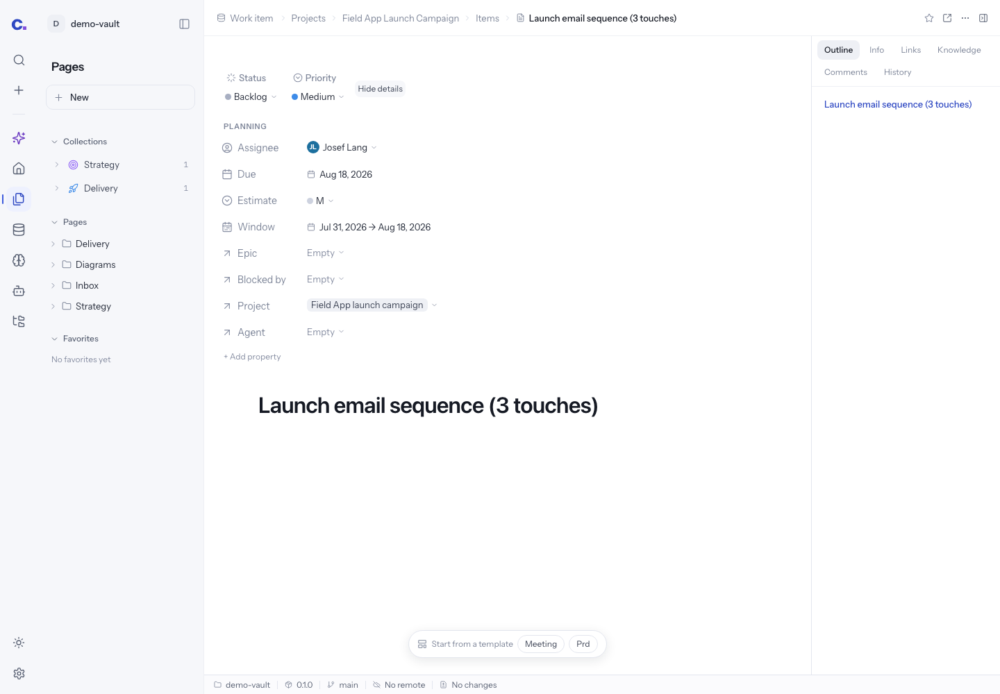
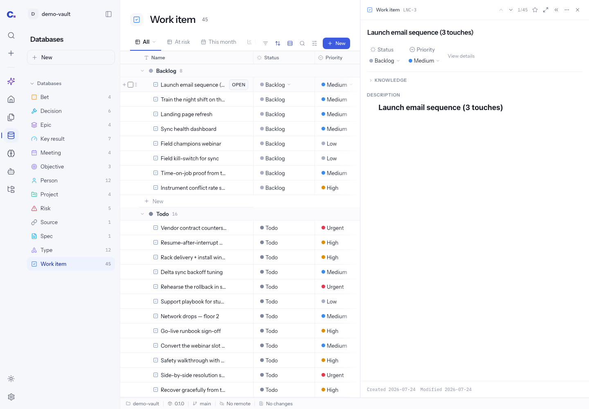
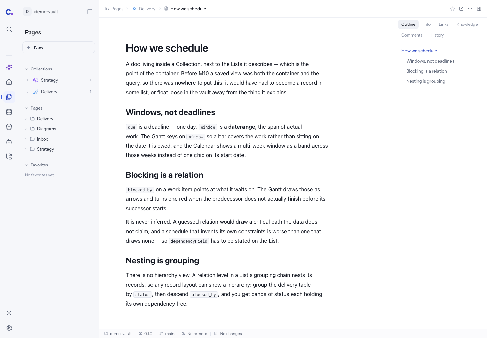
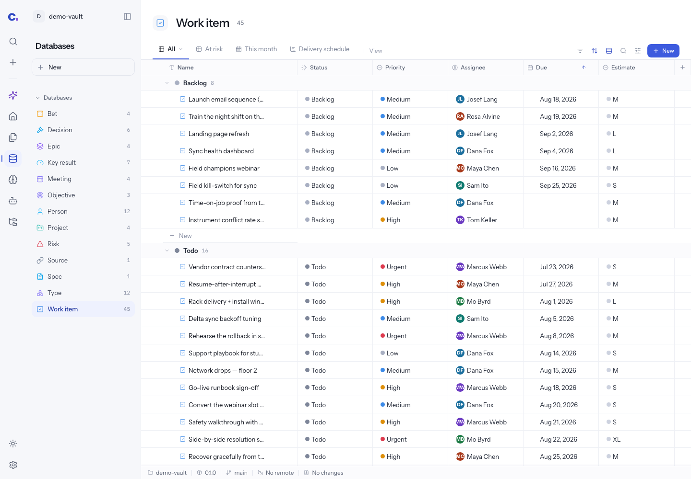
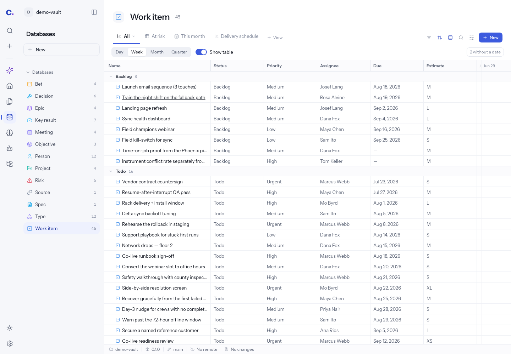

# Cerebro polish audit and reference evidence

**Research for the M84–M90 draft · 2026-10-17.** Read alongside the
[design direction](2026-10-17-cerebro-product-polish.md). Observations describe the working
tree inspected on this date, which contains staged changes beyond HEAD `9196fe3`.

Three parallel source audits examined pages/editor, databases/views, and the shell/surface
system. The primary audit inspected Cerebro in headless Chromium against an isolated Vite
server and the browser demo backend. Morrow's supplied demonstration video was also visually
reviewed. Neither reference app was installed or run against a vault.

## Evidence boundary

| Evidence                                          | What it establishes                                                                              | What it does not establish                                                         |
| ------------------------------------------------- | ------------------------------------------------------------------------------------------------ | ---------------------------------------------------------------------------------- |
| 33 browser captures                               | Current composition across the main surfaces, alternate views, menus and four History lab states | Complete interaction regression, packaged macOS behavior, all themes at every size |
| Source and existing tests                         | Existing capabilities, explicit constraints, rendering branches and implementation risks         | That all those tests pass on this working tree today                               |
| Morrow local source and video                     | Its page hierarchy, typography relationships, editor/menu choices and data model                 | Quality of every runtime state, or suitability of its architecture for Cerebro     |
| Macro local source and previous reference dossier | Rail/sidebar/pane/toolbar and editor behavior patterns                                           | A reason to import its code, cloud model or styling wholesale                      |
| Existing M53–M83 plans                            | Prior decisions and recorded verification                                                        | Fresh acceptance of the next design or closure of earlier native/live gaps         |

The audit used port 5379 after checking it was free, imported `e2e/boot.ts`, pinned
`VAULT_TODAY` and UTC, and disabled background learning. Screens use 1440×1000 except the
900×700 document capture. Light is the main audit theme; document, database and assistant
also have dark captures. Switching layouts changed only the disposable browser mock files.
The repository demo vault and app sources were not edited. Node 24.14.0 and pnpm 9.15.9 differ
from the repository pins; this preview is design evidence, not release verification.

The [snapshot manifest](2026-10-17-polish-audit/manifest.json) records the source HEAD, staged
diff fingerprint and hashes of retained screenshots. The concept previews are stored separately
from these current-app observations.

## Findings by priority

Priority denotes the proposed order of design work, not a claim that every judgment is a
functional bug. **Observed** means seen in a current screenshot. **Source** means verified in
code. **Judgment** names the proposed design interpretation.

| ID  | Finding and evidence                                                                                                                                                                                                                                   | Consequence                                                                                                   | Proposed owner |
| --- | ------------------------------------------------------------------------------------------------------------------------------------------------------------------------------------------------------------------------------------------------------ | ------------------------------------------------------------------------------------------------------------- | -------------- |
| A01 | **Observed + source:** Full-page record properties precede the stored title; expanding them pushes the title far down. `DocPage.tsx` mounts its fallback title only when no title block exists, before properties; the real editor appears after them. | A record introduces its configuration before its identity.                                                    | M85            |
| A02 | **Observed:** Record peek repeats the title above and inside the body.                                                                                                                                                                                 | Two title treatments compete; editing ownership is unclear.                                                   | M85            |
| A03 | **Source:** A title inside the Overview editor is not the shared visible page heading on related tabs.                                                                                                                                                 | The same record changes its identity hierarchy when switching tabs.                                           | M85            |
| A04 | **Observed + judgment:** Prose pages are more coherent than records, but a default Outline pane occupies a large portion of the available width, including at 900px.                                                                                   | Improve default disclosure before redesigning the shell again. Preserve saved choices.                        | M85            |
| A05 | **Source:** Full-page top-level prose was raised to 16px in M82; nested/custom prose follows older styling in places.                                                                                                                                  | Rich pages change reading rhythm between block kinds.                                                         | M86            |
| A06 | **Source:** Block grip actions are much thinner than Morrow's turn-into, duplicate and move actions.                                                                                                                                                   | Existing rich content lacks equally polished authoring affordances.                                           | M86            |
| A07 | **Source + judgment:** Selection actions combine writing, formatting and AI concerns; custom blocks and rich embeds have independent chrome.                                                                                                           | Establish one clear priority and consistent menus without losing supported actions.                           | M86            |
| A08 | **Observed:** Many Work item names truncate at 1440px, while small metadata fields use generous widths.                                                                                                                                                | Identifying records becomes unnecessarily dependent on opening or hovering them.                              | M87            |
| A09 | **Source:** Table title editing clears its draft before awaiting a refused rename; scalar field editing retains a failed draft.                                                                                                                        | Equivalent edits have inconsistent recovery. This needs behavior work, not just CSS.                          | M87            |
| A10 | **Observed:** View settings contains both display controls and Delete database.                                                                                                                                                                        | Presentation and entity-level actions need clearer scope. Existing destructive confirmation remains required. | M87            |
| A11 | **Observed + judgment:** Board cards repeat category color in a heading dot and card stripe; metadata wraps without a consistent hierarchy.                                                                                                            | The board reads busier than its underlying data requires.                                                     | M88            |
| A12 | **Observed + source:** Gallery uses one-line titles, while each selected field receives its own row.                                                                                                                                                   | Names lose prominence to metadata. Card-size choices should have a useful title policy.                       | M88            |
| A13 | **Source:** Gallery fixed minimum tracks and List's unconditional 720px minimum can exceed narrow embedded content.                                                                                                                                    | Container width, not only window width, must determine reflow.                                                | M88            |
| A14 | **Observed + source:** In Gantt, inherited visible columns consume almost all horizontal space, leaving only a thin slice of time axis.                                                                                                                | The view cannot communicate its primary information at an otherwise normal window size.                       | M88            |
| A15 | **Observed + judgment:** Calendar and time bars use repeated strong outlines; dates and clipped labels have small secondary styling.                                                                                                                   | Improve the hierarchy of dates, events, ranges, selection and today's marker.                                 | M88            |
| A16 | **Source + judgment:** Chart/dashboard/sheet tools have distinct framing, configuration and empty-state conventions.                                                                                                                                   | Coordinate controls and reading hierarchy while preserving separate engines and interaction models.           | M88            |
| A17 | **Source:** Shared tokens exist, but header/control dimensions are independently declared across Inbox, chat, documents, whiteboards and PageHeader.                                                                                                   | New top-level chrome did not produce a complete component composition system.                                 | M84            |
| A18 | **Source calculation:** White primary-button text has about 3.59:1 contrast on its dark-theme hover fill and 2.31:1 on its pressed fill; dark danger states also need attention.                                                                       | Test semantic foreground/background pairs in every state, rather than only resting colors.                    | M84            |
| A19 | **Source calculation + observed:** Light `n-500` on white is about 3.65:1 and is used for readable metadata and state text.                                                                                                                            | Secondary information is too faint in places; reduce emphasis through composition, not low contrast.          | M84/M89        |
| A20 | **Source:** `text-base` appears at several sites although the Tailwind type scale is reset without that token being mapped.                                                                                                                            | Audit actual computed type; remove accidental reliance on inheritance.                                        | M84            |
| A21 | **Observed + judgment:** Home/My work, Agents and History use different row rhythms; tiny operational metadata competes with repeated section labels.                                                                                                  | Establish a small family of work, activity and decision rows. Keep each surface's semantics.                  | M89            |
| A22 | **Observed:** History's unavailable lab preset truthfully preserves checkpoints while explaining the failed activity read.                                                                                                                             | Retain this state distinction while improving the message's legibility.                                       | M89/M90        |
| A23 | **Existing records:** Automated/browser completion and local signing are recorded separately from native interactive acceptance.                                                                                                                       | A fresh visual program must not treat a build as visual sign-off.                                             | M90            |

Code details and exact ownership are expanded in the three domain specifications. Cosmetic
judgments above are recommendations, not evidence that existing data semantics are wrong.

## Current page and record evidence

### Expanded properties precede the record title

Open Databases → Work item → first record → Open in full page → View details. The page's
identity appears below the expanded property stack. The narrow breadcrumb is useful context
but does not replace the content heading.

### Peek duplicates the title

The same first Work item in the table peek shows the record heading and the body H1. The
proposed single-title model must preserve the file's actual title block and editor lifecycle.

### Prose already has a usable reading foundation

The current How we schedule document demonstrates an existing 16px reading scale and
restrained heading hierarchy. Preserve what works, then apply it consistently to nested
blocks and record bodies. Compare the [900px dark capture](2026-10-17-polish-audit/17-document-narrow.png)
to assess how the details panel affects the available reading space.

## Current database and display evidence

### Default identifying columns need more attention

The Work item database has 45 rows in this demo. Several everyday names truncate despite a
wide window. This is a composition problem; resize, fit, freeze, wrap, grouping, sorting and
keyboard editing already exist and are not proposed as new features.

### The Gantt table crowds out its time axis

Changing the active view layout to Gantt retains the table's visible columns. At 1440px, the
table consumes nearly all of the content width. The next design needs an explicit shared
space budget, including a useful minimum axis width and independently managed table overflow.

### Cards and configuration are functional but need hierarchy

The [board](2026-10-17-polish-audit/20-board.png) and
[gallery](2026-10-17-polish-audit/21-gallery.png) show the same records with different title,
key and metadata arrangements. A common card anatomy should preserve their purposeful
differences. The [view settings menu](2026-10-17-polish-audit/28-display-settings.png) shows
why database actions need their own scope.

## Reference transfer map

Paths below share the `docs/examples/` root unless written in full. They refer to vendored
local study material, excluded from project lint/test
inventories. The Morrow local `LICENSE` and package metadata identify Apache-2.0. The existing
Macro roadmap's guided-rebuild decision remains the working approach. No reference code,
styles, fonts or brand assets were copied into product code for this task.

| Local reference                                                        | Useful evidence                                                                                            | Translation into Cerebro                                                                           |
| ---------------------------------------------------------------------- | ---------------------------------------------------------------------------------------------------------- | -------------------------------------------------------------------------------------------------- |
| `docs/examples/Morrow-main/Morrow.mp4`                                 | A title-first document, restrained properties, content-aligned view controls and a focused writing surface | Page composition and disclosure; not its product feature scope                                     |
| `Morrow-main/src/app/components/PageView.tsx`                          | Title, properties and page composition                                                                     | Study the visible hierarchy without adopting a metadata-title model                                |
| `Morrow-main/src/app/editor/PageEditor.tsx`                            | Body editor lifecycle and external-update integration                                                      | Do not adopt external `setContent` replacement over Cerebro's reconcile                            |
| `Morrow-main/src/app/editor/EditorMenus.tsx`                           | Grouped writing actions and block manipulation                                                             | Offer only carrier-safe operations through Cerebro's one editor                                    |
| `Morrow-main/src/core/markdown/serialize.ts`                           | Formatting and table serialization choices                                                                 | Its HTML colors/underline/columns and table-header behavior show why menus cannot simply be copied |
| `macro-main/apps/web/src/components/view-shell/ViewSidebar.tsx`        | Shared sidebar/header/content slots                                                                        | Derive alignment from a small shared composition system                                            |
| `macro-main/apps/web/src/components/app/sidebar-next/sidebar-rail.tsx` | Persistent global navigation                                                                               | Keep the already-implemented Cerebro rail and destination model                                    |
| `macro-main/apps/web/src/components/app/split-layout/SplitLayout.tsx`  | Stable pane/focus composition                                                                              | Preserve mounted editing state while improving proportions                                         |
| `macro-main/apps/web/src/features/block-chat/component/Chat.tsx`       | Bounded, aligned transcript and composer                                                                   | Finish message/card states within Cerebro's existing single assistant                              |

Morrow also offers unrelated functions such as graph, flashcards and vault encryption. They
are not implied requirements of this visual request. Cerebro already has richer guarded
agent work and many data capabilities; their presence is a reason to design better
disclosure, not to replace the domain model with a simpler reference implementation.

## Coverage and remaining inspections

The [contact sheet](2026-10-17-polish-audit/current-contact.png) contains the first 19 captures
in order: Home, Inbox, My work, Library, Knowledge, Agents, History, Settings, Work, Studio,
table, peek, full record, expanded record, light document, dark document, narrow document,
dark table and assistant. Additional captures inspect board, gallery, list, calendar,
timeline, Gantt, chart, dashboard, view settings, a property popover and History lab states.

The [History unavailable capture](2026-10-17-polish-audit/30-history-unavailable.png) is a
deliberate failure preset, not a newly discovered read failure. Work and Studio screenshots
show their unconfigured/empty demo states; this audit does not claim populated native folder
or project-preview verification. Whiteboards, media/PDF, spreadsheet interactions, live
assistant decisions and dense configuration dialogs were source-audited; their full visual
matrix is a required implementation deliverable rather than claimed current coverage.

M90 explicitly includes Chromium and WebKit, light/dark, 900/1024/1280/1440/1920px windows,
narrow pane containers, 200% zoom, keyboard-only operation, reduced motion, VoiceOver and
packaged macOS behaviors. No production app was built, installed or launched for this audit;
no live CLI, account connector or user-vault action was exercised. Full repository test suites
were not run because the deliverable changes only review documents and evidence.
