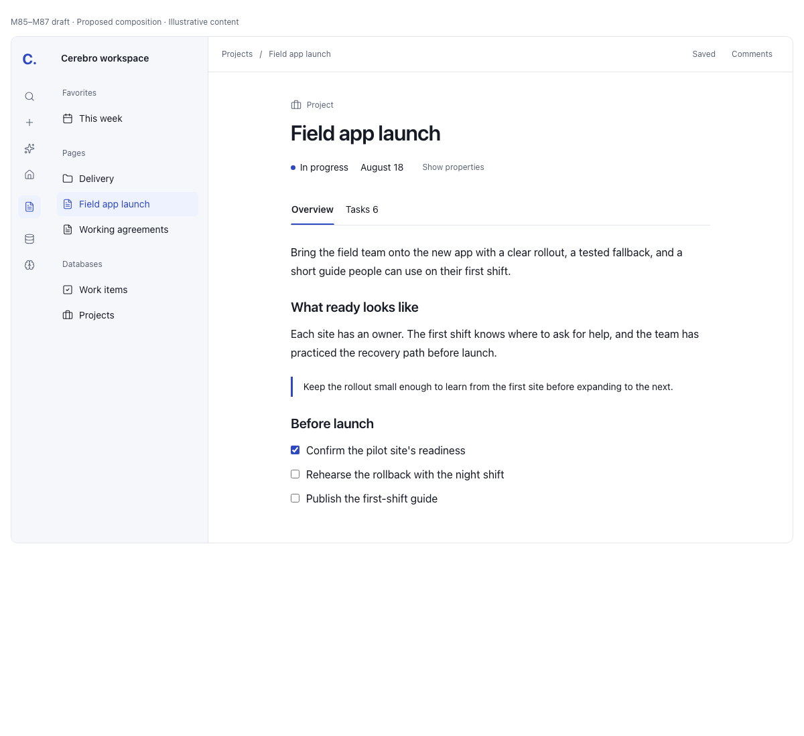

# Cerebro product polish M84 through M90

**Design specification · 2026-10-17. Implementation subsequently authorized by the owner.**
This document preserves the reference-based direction and acceptance contract. Actual changes,
verification and remaining visual/native acceptance are recorded in the
[implementation record](../plans/2026-10-17-m84-m90-implementation-record.md).

Cerebro should feel like one carefully designed workspace when moving from a page to a
record, database, board, conversation or file. Keep the Macro-inspired shell and use Morrow's
content hierarchy as the next reference: a clear title, useful metadata, a comfortable body,
and tools that become prominent when needed. Preserve Cerebro's Instrument Sans, IBM Plex
Mono, cortex/synapse identity and files-first behavior.

The main problem is inconsistent composition inside the frame. In the current browser build,
an expanded record places its title below hundreds of pixels of properties; its peek repeats
the title. Tables truncate ordinary names while giving comparable space to small values.
Gallery cards emphasize metadata over titles. A Gantt view can devote almost its entire
canvas to its table. These are visible examples of a broader mismatch between strong
capabilities and the way they are presented.

Page authoring is a central part of this redesign. Morrow and Macro inform the complete editing
experience: title/body flow, contextual formatting and link/table controls, block manipulation,
selection feedback and continuing around embedded content. M85–M86 must demonstrate those
interactions on a finished page. Supporting the same block types is not enough to meet that bar.

## Review packet

| Read                                                                               | Purpose                                                                                        |
| ---------------------------------------------------------------------------------- | ---------------------------------------------------------------------------------------------- |
| This specification                                                                 | Direction, scope, decisions and milestone map                                                  |
| [Audit and reference evidence](2026-10-17-cerebro-polish-audit.md)                 | What was observed in Cerebro, Morrow and Macro; screenshots and limitations                    |
| [Pages and editor](2026-10-17-cerebro-pages-and-editor.md)                         | M85–M86: page anatomy, properties, title ownership, authoring, rich content and comments       |
| [Databases and views](2026-10-17-cerebro-databases-and-views.md)                   | M87–M88: tables, saved views, display settings, cards, calendars, timelines, charts and sheets |
| [Surface system and quality](2026-10-17-cerebro-surface-system-and-quality.md)     | M84/M89/M90: shared rules, remaining surfaces, accessibility and release evidence              |
| [Milestone implementation sequence](../plans/2026-10-17-m84-m90-product-polish.md) | Deliverable phases, dependencies, ownership and acceptance gates                               |

The October 16 [M71–M79 design](2026-10-16-cerebro-workspace-redesign.md) and
[M80–M83 plan](../plans/2026-10-16-m80-m83-ui-polish.md) already allocate those milestone
numbers. This packet continues at **M84**; it neither renumbers nor reopens completed
implementation as new work. Earlier native/live acceptance remains open where recorded.

## Proposed page composition

The accompanying interactive preview illustrates a single title above configured properties,
with Overview and related Tasks below them. Properties and comments can be revealed without
changing the page's identity. Its content is illustrative; the production editor/title spike
and saved-view behaviors still require the implementation proof specified below.

Compare the [expanded properties and related tasks](2026-10-17-polish-review/proposed-tasks.png)
and [dark appearance](2026-10-17-polish-review/proposed-dark.png). These are design concepts,
not screenshots of an implemented Cerebro change. The preview concentrates on the page
hierarchy and uses simplified surrounding controls; the application retains all destinations.

## What professional means here

1. **The subject leads.** A page's title appears once in the content hierarchy, above its
   properties and tabs. A record card gives its name more attention than its tags. A table
   gives the identifying field enough space to recognize its rows.
2. **The same thing behaves the same way.** A field's value, empty state, editing behavior,
   permissions and failure are consistent in a table, page, card and peek. Shared visual
   anatomy does not erase genuine differences between a database grid and a spreadsheet.
3. **Density is deliberate.** Reading pages have a comfortable measure. Data views use the
   available width. Compact rows remain an intentional preference, not an accumulation of
   tiny labels. Controls use a small agreed set of dimensions.
4. **Context stays close.** Properties belong below the title, on every record tab. Comments,
   evidence and history open beside the subject when requested. Editing display settings
   shows their effect without obscuring the whole result.
5. **Quietness preserves meaning.** Reduce repeated headings, borders and tinted containers.
   Keep failures, unsaved changes, permission decisions and partial results conspicuous.
   Gray text is not a substitute for a sensible hierarchy.
6. **Finishing includes interaction.** Keyboard ownership, menu placement, scroll restoration,
   dragging, selection, caret stability, loading and save failures are part of the design.
   A polished resting screenshot alone cannot close a phase.

## Reference decisions

| Reference | Carry forward                                                                                                                                                                                           | Translate or exclude                                                                                                                                                                                           |
| --------- | ------------------------------------------------------------------------------------------------------------------------------------------------------------------------------------------------------- | -------------------------------------------------------------------------------------------------------------------------------------------------------------------------------------------------------------- |
| Macro     | Persistent global rail, contextual navigation, aligned sidebars and toolbars, stable pane ownership, one assistant with multiple presentations; deliberate title/body navigation and selection feedback | Retain Cerebro's accepted 54px rail and 240px default context. Translate editor interactions through Cerebro's document owner. No cloud/team model or wholesale style import.                                  |
| Morrow    | Title-first pages, restrained metadata, discoverable block handles, coherent menus, deliberate reading measure, straightforward database composition                                                    | Keep BlockNote, Cerebro's carriers, guarded writes, panes and agent semantics. Morrow's raw HTML formatting, editor replacement on external updates and database state model are not implementation templates. |
| Cerebro   | Local files, page identity, editable Type docs, saved views, guarded knowledge, traceable agent work, real history and undo                                                                             | Consolidate presentation around existing behavior. Avoid type-name routing, speculative statistics and a parallel design framework.                                                                            |

Morrow is useful because page content remains the visual center. Its smaller feature surface
does not prove that a feature-rich Cerebro should omit operational facts. The translation is
to show those facts at the right level and in a consistent form. Its code also has limitations
that conflict with Cerebro's lossless editing guarantees; the detailed editor spec names them.

## Proposed visual direction

Use neutral surfaces with a clear difference between navigation, content and temporary
overlays. Keep body text dark enough to read, even when it is secondary. Reserve cortex for
navigation, focus and ordinary primary actions; synapse continues to identify assistant
activity. Entity/status colors remain meaningful user data, not decorative striping on every
card or outline on every time bar.

Keep 32px page titles, 24px surface headings and 16px document prose as the starting scale.
Apply the prose rhythm to nested prose as well as top-level paragraphs. Use 13–14px working
UI text and 12px secondary labels; 11px is reserved for nonessential compact annotations.
Do not make text smaller to fit a layout. Establish control, row, menu and spacing roles in
M84; avoid a broad token replacement without proving its effect on real screens.

Page, record and database layouts share a family resemblance, with three working modes:

| Mode                     | Composition                                                                                                                       |
| ------------------------ | --------------------------------------------------------------------------------------------------------------------------------- |
| Reading                  | Quiet location bar; optional cover/icon; title; metadata if present; body at a bounded measure; contextual details on request     |
| Records and related work | Same title and property anatomy; related tabs below properties; table/card content can use broader width without stretching prose |
| Tools and data           | Compact location/title hierarchy; saved-view controls; broad primary work area; bounded secondary controls and explicit overflow  |

The shell's current navigation remains. This proposal does not add another permanent sidebar,
top navigation tier or second assistant. A document's default side panel should be closed for
new preferences and available from a labeled action. Existing explicit preferences stay
respected; the implementation must distinguish an unset preference from a saved choice.

## Milestones

| Milestone                            | Outcome                                                                                                          | Principal review proof                                                                   |
| ------------------------------------ | ---------------------------------------------------------------------------------------------------------------- | ---------------------------------------------------------------------------------------- |
| **M84** Shared visual rules          | Typography, surfaces, contrast, controls, menu geometry and content frames have defined roles and real consumers | A page, a populated table and an operational decision card in both themes                |
| **M85** Pages and records            | One title-first anatomy across full page, peek and related tabs; restrained, legible properties                  | Long title, expanded properties, related tab, agent page and concept page                |
| **M86** Authoring and rich content   | Discoverable block actions, consistent text rhythm, usable media/tables/sheets, coherent comments and details    | A complete edit/save/reopen/Undo journey with selection and external updates             |
| **M87** Tables and saved views       | Readable default columns, clear grid/edit states, aligned controls and scoped display settings                   | Dense mixed-field database, keyboard edit, bulk failure and narrow peek                  |
| **M88** Alternate views and display  | Board/gallery/list/calendar/timeline/Gantt/chart/dashboard composition follows the same field and density rules  | Same source records across views, including small panes and missing data                 |
| **M89** Remaining workspace surfaces | Home, Inbox, Knowledge, Library, Agents, Assistant, History, Settings, Work, Studio and viewers adopt the rules  | Surface-by-surface coverage matrix with populated and failure states                     |
| **M90** Integrated acceptance        | Visual judgment, browser behavior and packaged native behavior are independently demonstrated                    | A reviewable evidence pack; no automatic claim that a successful build proves UI quality |

M84 should be small enough to prove through actual screens. M85 is the first substantial
vertical slice. M86 and M87 can proceed in parallel once page/title and field seams are agreed.
M88 follows M87's view frame. M89 can be divided by surface after M84. M90 verifies integration;
it is not where earlier phases defer their own visual inspection.

## Review decisions and recommended defaults

These are proposals for this review, not silently accepted changes to product behavior.

| Decision            | Recommended default                                                                                                 | Consequence                                                                                                                 |
| ------------------- | ------------------------------------------------------------------------------------------------------------------- | --------------------------------------------------------------------------------------------------------------------------- |
| Overall composition | Morrow's content hierarchy within Cerebro's existing Macro-inspired frame                                           | Concentrate effort inside pages and views, preserving learned navigation                                                    |
| Title ownership     | One logical title projected consistently from existing page bytes                                                   | Requires a bounded editor spike before moving title UI; no second editor or automatic file rewrite                          |
| Record metadata     | Existing configured heading fields below title, further properties expandable, property scope unchanged across tabs | Keeps context without inventing another property selection or making a record look like a configuration form                |
| Document details    | Closed when preference is unset; explicit existing choices preserved                                                | More reading space by default; comments/evidence/history remain one action away                                             |
| Table density       | Improve fallback defaults; preserve explicitly saved density and widths                                             | Existing workspaces do not change their saved display simply by opening                                                     |
| View configuration  | One scoped view menu with layout-appropriate sections; database destruction in database actions                     | Clear distinction between changing presentation and changing the underlying database                                        |
| Formatting scope    | Improve the supported tools first                                                                                   | Underline, arbitrary color/alignment and merged cells remain deferred until durable carriers have their own approved design |
| Performance work    | Profile representative long pages and large views, then optimize measured bottlenecks                               | No grid/editor rewrite justified only by a proposed visual style                                                            |
| Completion          | Owner reviews representative implemented screens at each milestone                                                  | The next polish pass is judged on the actual result, not a test count                                                       |

## Boundaries that remain in force

- The vault remains the source of truth. Opening, hovering, resizing or revealing a surface
  does not rewrite content. Persistent display changes use the existing view/page preference
  owner and occur only after the user's deliberate action.
- One file has one live editor. Moving between panes, peek and page retains or safely transfers
  that ownership; no duplicated save controllers, histories or comment-anchor interpretations.
- Every offered block and formatting action survives its existing carrier. Page comments
  remain sidecars. No raw HTML admission or new storage format is bundled into cosmetic work.
- Knowledge verification stays with its guarded bar. Agent grants still commit on Done.
  Presentation cannot approve a tool, start a run or conceal a queued approval.
- Absent, empty, filtered-out, partial and unavailable remain distinct. No invented totals,
  last-edited attribution, availability or progress.
- Stored destinations, Type/field identities, saved filters, relation semantics, exports,
  undo, rename propagation, import provenance and file-opening policy remain intact.

The detailed specs identify where a new capability is proposed, such as block Duplicate.
They also distinguish an existing capability whose composition should improve, such as table
freeze/wrap/resize, saved views, columns and comments. This distinction prevents a visual
program from becoming an unnecessary platform rewrite.

## Definition of success

A person can recognize the page they opened before reading its metadata; read ordinary row
names without constant tooltips; edit a field without confusing selection, hover and save;
switch views without losing their context; and understand a failure without opening logs.
The app looks related across all surfaces, but reading, working with data and talking to the
assistant retain the proportions each activity needs.

The owner subsequently authorized the complete M84–M90 sequence after a baseline commit.
The [implementation record](../plans/2026-10-17-m84-m90-implementation-record.md) distinguishes
implemented behavior, inspected specimens, automated verification and outstanding acceptance.
