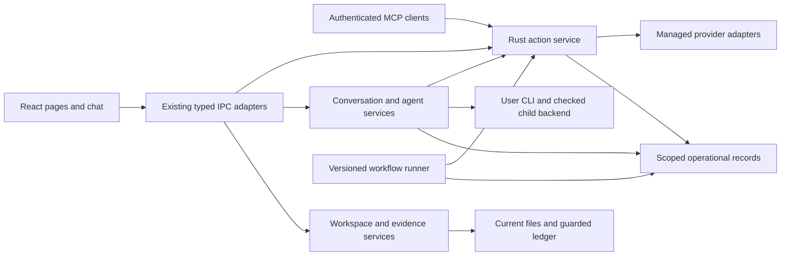

# M93–M99 — Cerebro program design

**Draft for owner review · 2026-10-23.** This is the integrated design for the
research across Macro, Morrow, Tolaria, Thought Desk, Activepieces, AppFlowy, n8n
and Plane, including M91, the M92 handoff and the four-pass UI review. It proposes a direction;
it does not approve implementation or change existing product contracts.

Start with the [M93–M99 master roadmap](../plans/2026-10-23-m93-m99-master-roadmap.md), then read this program design and the seven paired specs/plans below. The
[review index](2026-10-23-m93-m99-research/README.md),
[decision register](2026-10-23-m93-m99-research/decisions.md) and
[finding coverage](2026-10-23-m93-m99-research/traceability.md) make
the complete research reviewable without treating every reference feature as
something Cerebro should copy.

## Product intent

Cerebro should feel like a polished workspace in which pages, structured work,
knowledge and AI activity belong together. A person can write without losing a
draft, find supporting material precisely, understand an Agent's work, connect
an account, approve a concrete action and recover honestly when execution is
interrupted. Chat becomes a useful work surface with sources, artifacts and
supervised contributions. Repeatable work can become a versioned workflow.

The owner's requested direction is broader connectors/MCP/actions/subagents,
substantial investment in chat, a refined UI and a serious examination of Rust
and removing YAML. The specific limits, retention defaults and storage choice in
these documents are recommendations, not decisions the owner has already made.

## Approaches and proposed selection

| Approach                                                         | What it buys                                                               | What it gives up                                                                                          |
| ---------------------------------------------------------------- | -------------------------------------------------------------------------- | --------------------------------------------------------------------------------------------------------- |
| Polish the current application only                              | Fast visual and reliability gains                                          | Leaves account/action/recovery and durable-workflow goals unresolved                                      |
| Incremental Rust service core with parallel UI and evidence work | Useful improvements in independent slices; explicit authority and recovery | Requires disciplined shared contracts and phased adoption                                                 |
| One full Rust UI/storage/agent rewrite                           | Broad freedom to change representations                                    | Rebuilds rich-editor/native behavior, delays useful improvements and combines several unproven migrations |

Recommend the second approach. Preserve React, the current editor and the
accepted shell; deepen Rust ownership of durable services. Compare SQLite metadata
and JSON sidecars on copies before selecting a new workspace format. New actions
and polished screens do not depend on completing that migration.

## Current baseline, not yesterday's absence list

The [final source review](2026-10-23-m93-m99-research/final-review.md) incorporates the newer [M91 implementation record](../plans/2026-10-23-m91-implementation-record.md), which reports remaining baseline test failures and known gaps. Its counts are attributed evidence, not freshly executed passes. The master now gives an exact build sequence and affected-failure ownership before each increment.

M91 has advanced since the October 22 audit. Current source includes parent/child
projection, ordered parts, bounded child restoration, context usage, checked
branching, attachment import and production AI elements. The new M95 plan begins
with reconciliation and recorded integration acceptance, not implementing all of
those features again. Both policy loaders now recognize fields involved in the
earlier startup failure; this drafting task did not perform a fresh browser or
native startup check. Child-hop detail mounting is also present; history scope
and failed-read behavior remain separate findings.

The [evidence record](2026-10-23-m93-m99-research/evidence.md)
separates source observations, historical captures, protocol documentation and
unexecuted acceptance. None of the reference applications was run for this task.
Their code/images illustrate patterns; they are not performance or edition-parity
benchmarks. Historical packets remain unchanged and retain their original dates.

M92 separately owns the accepted conversation rail and its context/plan/subagent/source adapters. The [master handoff](../plans/2026-10-23-m93-m99-master-roadmap.md#existing-m91-and-m92-handoff) governs overlapping M94/M95 work; nothing here asserts M92 has shipped. Source-context receipts add provenance, not a second token-context poll or persistence of its memory-only readings.

## Seven milestone designs

| Milestone                                | Spec and implementation plan                                                                                                              | User-visible result                                                                              |
| ---------------------------------------- | ----------------------------------------------------------------------------------------------------------------------------------------- | ------------------------------------------------------------------------------------------------ |
| M93 — Reliable workspace                 | [Spec](2026-10-23-m93-reliable-workspace-design.md) · [Plan](../plans/2026-10-23-m93-reliable-workspace.md)                               | Retained saves, honest history/readiness, source recovery and measured scale.                    |
| M94 — UI polish and journeys             | [Spec](2026-10-23-m94-ui-polish-and-journeys-design.md) · [Plan](../plans/2026-10-23-m94-ui-polish-and-journeys.md)                       | Polished document, collection and utility surfaces; creation recovery and dependable navigation. |
| M95 — Chat and supervised agents         | [Spec](2026-10-23-m95-chat-and-supervised-agents-design.md) · [Plan](../plans/2026-10-23-m95-chat-and-supervised-agents.md)               | Recoverable conversations, precise source/artifact use and supervised child jobs.                |
| M96 — Connectors, MCP and actions        | [Spec](2026-10-23-m96-connectors-mcp-and-actions-design.md) · [Plan](../plans/2026-10-23-m96-connectors-mcp-and-actions.md)               | Managed accounts, MCP boundaries, durable approvals and action recovery.                         |
| M97 — Knowledge, evidence and evaluation | [Spec](2026-10-23-m97-knowledge-evidence-and-evaluation-design.md) · [Plan](../plans/2026-10-23-m97-knowledge-evidence-and-evaluation.md) | Precise source locations, scoped evidence/configuration and outcome evaluations.                 |
| M98 — Workflows and automation           | [Spec](2026-10-23-m98-workflows-and-automation-design.md) · [Plan](../plans/2026-10-23-m98-workflows-and-automation.md)                   | Versioned workflow authoring, durable steps/waits, preview and everyday automation.              |
| M99 — Rust services and storage          | [Spec](2026-10-23-m99-rust-services-and-storage-design.md) · [Plan](../plans/2026-10-23-m99-rust-services-and-storage.md)                 | Typed Rust services, storage comparison and a separately chosen YAML/metadata migration.         |

Each spec names goals, alternatives, data/state ownership, numbered requirements,
failure paths and decision gates. Each plan supplies file ownership, task interfaces,
checkbox steps and future verification. Existing CP/AX/UI IDs are mapped to these
milestones. M93–M99 are the canonical delivery identifiers; REL/CHAT/ACT/FLOW/KNOW/CORE/UX remain requirement and ownership labels, and historical research IDs stay traceable.

## Authority and shared boundaries

This is a target boundary diagram, not a claim that the shared action service
already exists. CLI-owned custom MCP remains a separately labeled compatibility
route with its existing limitations. A managed provider is not simultaneously
forwarded raw to the CLI. No retrieved page, remote tool description or workflow
template can grant capabilities.

| Contract                                                      | One owner | Consumers / rule                                                                             |
| ------------------------------------------------------------- | --------- | -------------------------------------------------------------------------------------------- |
| Save generation, retained draft and acknowledgement           | REL       | Editors, quit, navigation and chat launch consume the same outcome                           |
| Session creation draft, context, revision and submission      | UX        | FLOW may add an explicitly enabled persistence adapter later; never a second composer owner  |
| Normalized thread/attempt archive and child-job leases        | CHAT      | Runtime transactions/migrations belong to CHAT; CORE is not an unspecified dependency        |
| Action definitions, subjects, approvals, attempts and effects | ACT       | CHAT/FLOW reference IDs; rich details and revision checks come from ACT                      |
| Workflow version, step cursor, waits and prepare identity     | FLOW      | Durable step attempts reuse ACT's idempotent preparation; they do not own separate approvals |
| SourceLocator and evidence roles                              | KNOW      | Search, chat, backlinks and source reveal share types, scope and stale-source outcomes       |
| Workspace value/identity/format and transport conventions     | CORE      | Current file rules remain until selected migration; operational stores stay distinct         |

`outcome_unknown` is the canonical unresolved external-effect state. Missing cost
is not zero, failed reads are not empty and stopping generation is not proof an
outside mutation stopped. One local dispatch claim is not exactly-once remote
execution. Retry, compensation and a new chat attempt cannot bypass an unresolved
effect through a fresh identifier.

## UI direction and first useful slice

Keep Instrument Sans/IBM Plex Mono, cortex/synapse tokens, both themes, 54px rail,
240px default sidebar, one assistant, first-H1 editor ownership and the single
full-height page panel slot. Refine three compositions: document, collection and
utility. Align content edges, clarify Properties versus Details, reduce competing
actions and tune density by content. Preserve current control/row dimensions as
the baseline; proposed differences require same-content comparisons.

The first visual slice is a rich prose page, a record with inspector, Pages and
a populated table. Review light/dark, 1440/1024 windows, actual narrow pane and
real zoom before adopting the choices across chat, databases and utility surfaces.
The native minimum remains 900×600. An attractive static frame cannot close draft
recovery, focus, VoiceOver, IME, scale or external-effect correctness.

## First connected release and later commitments

The proposed narrow connected beta is one explicitly selected github.com account, acquired by native Rust from the person's gh login without passing its secret through React, one scoped issue read,
one reviewed issue create and one lost-response recovery. It proves account and
target binding, durable approval, idempotent preparation/claim and no automatic
repeat after remote success with a missing response. It should be inspectable
from chat and Runs and survive restart without manufacturing certainty.

Publication and activation are separate: a workflow starts disabled, binds a selected immutable version on Enable, and reconciles early durable outcomes before/after parking. GitHub is the first managed workflow; existing CLI-owned Gmail drafts remain a labeled compatibility route until a managed adapter is separately delivered.

Broader release work adds conversation retention after an explicit decision,
source/artifact continuity and three useful connector journeys. Workflows follow
the same action core, initially while the desktop is awake, with immutable
versions and bounded catch-up. Independently scoped child jobs require a backend
capability proof; styling a foreground researcher as a job is insufficient.

Storage migration is a parallel research/decision track. Its first selected metadata conversion retains governed concept projection YAML and historical attestation codecs; every canonical metadata consumer and required backup category must have a tested disposition. A full-YAML-removal claim waits for a separately versioned ledger design and any remaining sheet/CLI carriers. Full Rust UI, general
always-on hosting, arbitrary code workflow steps, automatic sending/publishing,
global semantic graphs and CRDT bodies are not part of the first release. Some
have bounded experiment or re-entry criteria in the coverage register; none is
silently counted as delivered.

## Approval and completion boundaries

Review can accept a workstream while deferring its optional extension or retention
choice. [Decisions](2026-10-23-m93-m99-research/decisions.md) separates
recommendations from current contracts. The [delivery plan](../plans/2026-10-23-m93-m99-master-roadmap.md)
shows what can proceed independently and which tasks are gated.

An implementation release needs matching source/build identity, meaningful
regressions, complete journeys and explicit visual/native/live/performance
dispositions. This documentation update needs source/coverage/link/format checks
and independent builder review. Those are different completion criteria. The
current deliverable is the latter: a complete proposal for review, with owner
decisions left visible and no product implementation performed.
